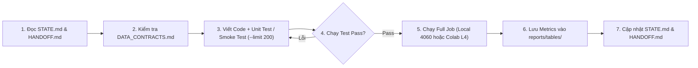

# AGENTS.md — HƯỚNG DẪN ĐIỀU PHỐI HỆ THỐNG MULTI-AGENT & QUY TẮC LÀM VIỆC

> **ĐỌC FILE NÀY ĐẦU TIÊN TRƯỚC KHI VIẾT BẤT KỲ DÒNG CODE NÀO!**
> Repository này được thiết kế để vận hành theo mô hình **Lead Agent (Kiến trúc sư trưởng / Điều phối viên)** kết hợp cùng **Developer (Người dùng)** và các **Specialized Sub-Agents (Agent thực thi chuyên biệt)**.

---

## 1. Thứ tự Đọc Tài Liệu Bắt Buộc (Mandatory Reading Order)

Mỗi khi một Agent (hoặc phiên làm việc mới) được khởi tạo, bắt buộc phải đọc theo đúng thứ tự sau để nắm ngữ cảnh:

1. **[`AGENTS.md`](AGENTS.md)** *(File hiện tại)*: Nắm vai trò, quy tắc bất khả xâm phạm và quy trình bàn giao.
2. **[`docs/STATE.md`](docs/STATE.md)**: Xem trạng thái hiện tại của dự án — Task nào đã xong, Task nào đang làm, các chỉ số thực nghiệm đã đo được và trạng thái các Decision Gates.
3. **[`docs/HANDOFF.md`](docs/HANDOFF.md)**: Đọc bản ghi bàn giao gần nhất để biết Agent trước vừa làm gì, để lại file nào, có lưu ý hay lỗi tồn đọng gì.
4. **[`docs/MASTER_PLAN.md`](docs/MASTER_PLAN.md)**: Xem chi tiết Work Package (`WP-xx`) và Task (`TASK-xx`) được giao, tiêu chí nghiệm thu (Acceptance Criteria) và điều kiện qua cổng (Decision Gate).
5. **[`docs/DATA_CONTRACTS.md`](docs/DATA_CONTRACTS.md)**: Kiểm tra chính xác tên cột, kiểu dữ liệu, đường dẫn file, schema Qdrant/Redis/Kafka/FastAPI trước khi code.
6. **[`docs/ARCHITECTURE.md`](docs/ARCHITECTURE.md)** & **[`docs/INFRA_AND_COLAB_GUIDE.md`](docs/INFRA_AND_COLAB_GUIDE.md)**: Hiểu thiết kế kiến trúc v3 và giới hạn tài nguyên phần cứng (Laptop RTX 4060 8GB VRAM, 24GB RAM $\leftrightarrow$ Colab Pro+ 200 CU).

> **Lưu ý:** Thư mục [`docs/ke_hoach_ban_dau/`](docs/ke_hoach_ban_dau/) chỉ chứa lịch sử thảo luận ban đầu, **KHÔNG** dùng làm tài liệu đặc tả khi code.

---

## 2. Phân công Vai trò trong Hệ thống (Agent Roles)

| Vai trò (Role) | Trách nhiệm chính | Phạm vi thư mục được phép sửa |
| :--- | :--- | :--- |
| **1. Lead Architect Agent** *(Bạn — Agent chính)* | Lập kế hoạch, kiểm tra chất lượng (Code Review), đánh giá các Decision Gates, giao việc cho Sub-Agents, cập nhật `MASTER_PLAN.md` và `STATE.md`, giải quyết xung đột tích hợp. | Toàn bộ repo |
| **2. Data & Lakehouse Sub-Agent** | Xây dựng pipeline PySpark Batch (`B0` $\rightarrow$ `B8`), Delta Lake (Bronze/Silver/Gold), Kafka Event Simulator, Spark Structured Streaming (`S1` $\rightarrow$ `S4`), đồng bộ Redis. | `spark_jobs/`, `src/streaming/`, `configs/spark_config.yaml`, `tests/` |
| **3. Computer Vision Sub-Agent** | Chuyển đổi dữ liệu Fashionpedia, benchmark Zero-shot Embeddings (CLIP, SigLIP-2, FashionSigLIP), huấn luyện/xuất ONNX cho YOLO11 & LoRA, đánh chỉ mục Qdrant, đánh giá 3 tầng (In-domain, CatConsistency, VN Set). | `src/cv/`, `colab/`, `scripts/`, `configs/class_mapping.yaml`, `tests/` |
| **4. RecSys Modeling Sub-Agent** | Xây dựng các baseline (Popularity, Repurchase, Co-occurrence), Spark ALS, tính feature GPU (`features_gpu.py`), huấn luyện LightGBM LambdaRank và mạng Two-Tower Neural Retrieval. | `src/recsys/`, `src/metrics/`, `configs/model_config.yaml`, `tests/` |
| **5. Serving & UI Sub-Agent** | Xây dựng FastAPI Backend (`/visual-search`, `/recommend`, `/outfit`, `/events`), tích hợp ONNX Runtime & LightGBM Online, xây dựng giao diện Streamlit (E-Commerce + Dashboard + Labeling Tool). | `src/backend/`, `src/frontend/`, `src/contracts/`, `docker-compose.yml`, `tests/` |

*Danh sách mẫu câu lệnh (Prompt Templates) để Lead Agent hoặc Người dùng gọi từng Sub-Agent nằm tại [`docs/SUBAGENT_PROMPTS.md`](docs/SUBAGENT_PROMPTS.md).*

---

## 3. 8 Quy Tắc Vàng Bất Khả Xâm Phạm (Golden Engineering Rules)

Mọi Agent khi viết code vào repo này bắt buộc phải tuân thủ 8 quy tắc sau:

1. **TUYỆT ĐỐI KHÔNG BỊA SỐ LIỆU (Zero Hallucinated Metrics):**
   - Không bao giờ tự điền các con số giả định vào báo cáo, README hay bảng kết quả. Mọi con số chưa chạy thực nghiệm phải ghi là `[TBD]`. Khi chạy xong phải lưu file kết quả JSON/CSV vào `reports/tables/` kèm seed và timestamp.
2. **Bảo toàn Định danh `article_id` (10-char Zero-Padded String):**
   - `article_id` của H&M bắt buộc phải là chuỗi đúng 10 ký tự (ví dụ: `"0108775015"`). Luôn dùng hàm chuẩn hóa `normalize_article_id()` trong [`src/utils/id_utils.py`](src/utils/id_utils.py) hoặc khai báo `StringType()` tường minh trong Spark. Nghiêm cấm dùng `inferSchema=True` khi đọc CSV gốc.
3. **Nén Định danh `customer_id` sang `customer_idx` (`int32`):**
   - `customer_id` gốc dài 64 ký tự hex. Từ tầng Silver trở đi, mọi phép tính Join, ALS, LightGBM, Two-Tower đều phải dùng cột `customer_idx` (`int32`) và tra cứu qua bảng `silver/customer_mapping` để tiết kiệm RAM.
4. **Chống Rò rỉ Dữ liệu Thời gian (Strict Temporal Split — Zero Leakage):**
   - Tuần kiểm định (Validation Week) cố định là **`2020-09-16` đến `2020-09-22`** (7 ngày cuối cùng của bộ H&M).
   - Khi tính feature cho bất kỳ tuần nhãn $[t_{\text{start}}, t_{\text{end}}]$ nào, **chỉ được phép dùng các giao dịch có `t_dat < t_start`**.
5. **Chống Tràn RAM ở Bước Huấn luyện LightGBM (Active-User Filtering):**
   - Khi tạo bảng huấn luyện cho LightGBM (`B7_features`), **chỉ lấy các khách hàng thực sự có giao dịch mua hàng trong tuần nhãn (~70.000 khách/tuần)** nhân với ~50–100 ứng viên/khách ($\approx 5\text{--}7$ triệu dòng). Không bao giờ tạo bảng feature cho toàn bộ 1,37 triệu khách cùng lúc trên máy 24GB RAM.
6. **Tuân thủ Ngân sách VRAM 8GB (RTX 4060) & Cuộc gọi Colab Pro+:**
   - Mọi script huấn luyện hoặc trích xuất vector đều phải chạy thử (**Smoke Test**) trên một tập nhỏ (`--limit 200` hoặc `--smoke-test`) ở máy local trước khi chạy toàn bộ hoặc đưa lên Colab.
   - Mọi mô hình đưa vào FastAPI Serving bắt buộc phải xuất ra chuẩn **ONNX FP16** (hoặc dùng `torch.inference_mode()` + `fp16`), tổng VRAM sử dụng trong FastAPI không vượt quá **1.5 GB**.
7. **Không Phá Vỡ Data Contracts:**
   - Nếu một Agent cần thêm cột hoặc đổi tên trường trong bảng Parquet/Delta, Redis hoặc Qdrant, Agent đó phải cập nhật [`docs/DATA_CONTRACTS.md`](docs/DATA_CONTRACTS.md) và [`src/contracts/schemas.py`](src/contracts/schemas.py) trước tiên.
8. **Cập nhật `STATE.md` và `HANDOFF.md` Trước Khi Kết Thúc Phiên:**
   - Không một nhiệm vụ nào được coi là hoàn thành nếu Agent chưa chạy test kiểm chứng và chưa ghi nhật ký bàn giao vào [`docs/HANDOFF.md`](docs/HANDOFF.md) cùng trạng thái mới vào [`docs/STATE.md`](docs/STATE.md).

---

## 4. Quy trình Làm việc Chuẩn cho Mỗi Nhiệm vụ (Task Execution Lifecycle)

