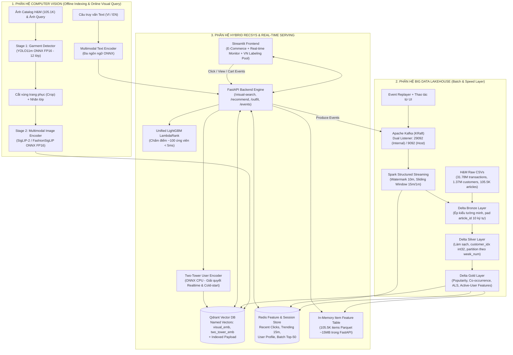

# KIẾN TRÚC HỆ THỐNG CHI TIẾT (SYSTEM ARCHITECTURE v3)

> **Phiên bản:** v3.0 (Production-Ready cho Laptop RTX 4060 8GB VRAM, 24GB RAM + Colab Pro+)  
> **Tài liệu liên quan:** [`docs/DATA_CONTRACTS.md`](DATA_CONTRACTS.md) · [`docs/MASTER_PLAN.md`](MASTER_PLAN.md) · [`docs/INFRA_AND_COLAB_GUIDE.md`](INFRA_AND_COLAB_GUIDE.md)

---

## 1. Sơ đồ Kiến trúc Tổng thể (End-to-End Architecture)

Hệ thống kết hợp **Kiến trúc Medallion Lakehouse + Lambda (Batch & Speed Layer)** cho môn Big Data, **Pipeline Thị giác Máy tính 2 Tầng (Detection $\rightarrow$ Multimodal Embedding)** cho môn Computer Vision, và **Kiến trúc Gợi ý Đa Tầng (Multi-Source Retrieval $\rightarrow$ LightGBM LambdaRank)** cho Hệ thống Gợi ý.

---

## 2. Thiết kế Chi tiết Từng Phân hệ

### 2.1. Phân hệ 1: Big Data Lakehouse & Stream Processing

#### A. Kiến trúc Medallion trên Delta Lake (`spark_jobs/batch/`)
Để tối ưu hóa hiệu năng I/O trên máy cá nhân 24GB RAM, hệ thống sử dụng **Delta Lake trên Local/WSL2 NVMe Filesystem** làm mặc định (và hỗ trợ chuyển sang **MinIO S3 `s3a://`** qua cấu hình `configs/paths.yaml` khi chạy bài đo so sánh lưu trữ):

1. **Tầng Bronze (`data/lakehouse/bronze/`):**
   - Job `b0_ingest_bronze.py` đọc 3 file CSV gốc với `StructType` khai báo tường minh (tuyệt đối không dùng `inferSchema`), kiểm tra `article_id` là chuỗi chữ số dương hợp lệ trước khi chuẩn hóa bằng `lpad(trim(col("article_id")), 10, "0")`. Chế độ `--smoke-test` ghi tách biệt vào `data/lakehouse_smoke/bronze/` để không bao giờ ghi đè dữ liệu chính.
   - Ghi nhận thêm luồng sự kiện thô từ Kafka thông qua job streaming `s1_bronze_sink`.
2. **Tầng Silver (`data/lakehouse/silver/`):**
   - Job `b1_clean_silver.py` thực hiện làm sạch giá trị thiếu (`age`, `club_member_status`, `detail_desc`), tạo bảng ánh xạ `silver/customer_mapping` chuyển `customer_id` (64-char hex) sang `customer_idx` (`int32`, kèm cột `mapping_version`).
   - Tính cột `week_num` neo tại Thứ Tư `2018-09-19` (`floor((t_dat - 2018-09-19) / 7)`), đảm bảo **Dev Week (`2020-09-09` $\rightarrow$ `2020-09-15`) có `week_num = 103`** và **Final Test Holdout Week (`2020-09-16` $\rightarrow$ `2020-09-22`) có `week_num = 104`** trọn vẹn 7 ngày mỗi tuần.
   - Phân vùng bảng giao dịch theo `week_num` (`partitionBy("week_num")`) và chạy `OPTIMIZE ... ZORDER BY (customer_idx, article_id)`.
3. **Tầng Gold (`data/lakehouse/gold/`):**
   - **`gold/popularity_global` & `gold/popularity_age` (`b3_popularity.py`):** Điểm phổ biến toàn cục và theo 4 nhóm tuổi (`16-22`, `23-30`, `31-45`, `46+`) có trọng số suy giảm hàm mũ theo ngày $w = \exp(-\lambda \cdot \Delta \text{days})$.
   - **`gold/cooccurrence_all` & `gold/cooccurrence_outfit` (`b4_cooccurrence.py`):** Ma trận đồng xuất hiện dựa trên **giỏ mua hàng theo ngày `(customer_idx, t_dat)` (Proxy Daily Basket)**. Xử lý bài toán lệch dữ liệu (**Data Skew**) bằng cách giới hạn giỏ hàng tối đa 30 món và chuẩn hóa theo chỉ số **Lift / Cosine**. Chia thành 2 bảng: `cooccurrence_all` (mọi nhóm cho RecSys) và `cooccurrence_outfit` (các món khác `detector_class` thường được mua cùng ngày, kết hợp quy tắc danh mục để phục vụ gợi ý phối đồ `/api/v1/outfit/{article_id}`).
   - **`gold/als_user_factors` & `gold/als_item_factors` (`b5_als.py`):** Vector ẩn của User và Item từ mô hình **Spark MLlib Implicit ALS** (`rank=64`).
   - **`gold/candidate_features` (`b6_candidates.py` & `b7_features.py`):** Bảng ứng viên và 24 đặc trưng chuẩn (`FEATURE_COLUMNS`) cho các `Active Users` trong từng tuần nhãn (`100..102` Train, `103` Dev, `104` Final Test).

#### B. Tầng Xử lý Luồng Thời gian thực (`src/streaming/` & `spark_jobs/streaming/`)
- **Nguồn sự kiện & Đồng hồ Streaming Thống nhất (Finding A08):**
  1. `event_simulator.py`: Phát lại (replay) các giao dịch lịch sử với `event_time` theo đồng hồ UTC trực tiếp hiện hành (cùng miền thời gian với sự kiện `"source": "ui"`) và lưu ngày giao dịch gốc tại trường `original_t_dat` (`"2020-09-18"`), giúp watermark không bao giờ loại nhầm sự kiện replay khi có tương tác từ UI.
  2. Tương tác từ giao diện Streamlit (`view`, `click`, `add_to_cart`, `purchase`) gắn nhãn `"source": "ui"`.
- **Spark Structured Streaming & Idempotent Redis Sink (`s1_stream_processor.py` — Finding A09):**
  - Đọc từ topic `fashion-events` trên Kafka KRaft (`KAFKA_LOG_DIRS=/var/lib/kafka/data`).
  - Áp dụng `withWatermark("event_time", "10 minutes")` và cửa sổ trượt `window("event_time", "15 minutes", "1 minute")` để tính **Real-time Trending Score**.
  - Ghi xuống Redis qua `foreachBatch` với cơ chế **Idempotent**:
    - Danh sách `user:{customer_id}:recent` (tối đa 50 món, TTL 7 ngày) được cập nhật qua `record_session_event_idempotent()` sử dụng khóa nguyên tử `event:seen:{event_id}` (`SET ... NX EX 86400`), đảm bảo một sự kiện đi qua cả API fast-path lẫn Spark retry chỉ được ghi đúng 1 lần.
    - Bảng xếp hạng `trend:15m` và `trend:15m:{detector_class}` chỉ xuất bản cửa sổ mới nhất (`max(window_end)`) bằng phép thay thế điểm tuyệt đối (`publish_trending_window_snapshot`), kèm khóa phiên bản `trend:15m:version`.

---

### 2.2. Phân hệ 2: Computer Vision Pipeline (`src/cv/`)

1. **Stage 1 — Phát hiện và Cắt vùng Trang phục (Garment Detection):**
   - Ánh xạ 46 lớp gốc của **Fashionpedia** về **12 lớp cốt lõi** (xem chi tiết tại [`configs/class_mapping.yaml`](../configs/class_mapping.yaml)): `top`, `outerwear`, `pants`, `shorts`, `skirt`, `dress`, `shoe`, `bag`, `hat`, `eyewear`, `scarf_tie`, `belt`. Wrapper `GarmentDetector` kiểm tra chặt `model.names` (`resolve_detector_class_from_model_names`) để ngăn việc dùng nhầm checkpoint COCO80 (`0: person`).
   - So sánh định lượng giữa **Detector Zero-shot** (`YOLO-World`) và **Fine-tuned `YOLO11m`** (`models/yolo11m_fashion_fp16.onnx`) về `mAP@50`, `mAP@50-95` và tốc độ suy luận.
2. **Stage 2 — Biểu diễn Đa phương thức (Multimodal Representation):**
   - Chia tập H&M theo `product_code` (`data/splits/hm_split_v1.parquet`: 85% Train / 7.5% Val-Dev / 7.5% Test-Final). Benchmark các mô hình Zero-shot (`CLIP ViT-B/32`, `SigLIP-2 Base`, `Marqo-FashionSigLIP` / `FashionCLIP`) với cấu hình padding chuẩn từng checkpoint (`padding="max_length", max_length=64` cho họ SigLIP) và loại trừ chính `article_id` truy vấn khi tính `I2I Precision@10`.
   - Nếu vượt qua **Gate CV-1**, thực hiện Fine-tune bằng **LoRA (rank 16)** trên Colab L4 và nội suy trọng số **WiSE-FT** ($\alpha \in \{0.3, 0.5, 0.7\}$).
3. **Stage 3 — Đánh chỉ mục Qdrant & Truy vấn kết hợp Ảnh + Text:**
   - Collection `hm_products` trên Qdrant lưu 2 vector có tên (**Named Vectors**): `visual_emb` ($D=512$ hoặc $768$, Cosine) và `two_tower_emb` ($D=64$, Dot), có kiểm tra tương thích chiều vector và `encoder_model_id` trong `ensure_collection()`.
   - Hỗ trợ tìm kiếm kết hợp ảnh + văn bản điều chỉnh (*Composed Image Retrieval*):
     $$\mathbf{v}_{\text{query}} = \text{normalize}\big(\alpha \cdot \mathbf{v}_{\text{img}} + (1 - \alpha) \cdot \mathbf{v}_{\text{text}}\big)$$

---

### 2.3. Phân hệ 3: Hệ thống Gợi ý Lai (Hybrid Two-Stage Recommendation Engine — `src/recsys/`)

Hệ thống được xây dựng theo **5 bậc tiến hóa (L0 $\rightarrow$ L4)**:

| Bậc | Tên phương pháp | Vai trò trong kiến trúc cuối |
| :--- | :--- | :--- |
| **L0** | **Time-Decayed Age Popularity** | Nguồn ứng viên xu hướng theo độ tuổi + Fallback cho khách hàng hoàn toàn mới (Cold-start User). |
| **L1** | **Repurchase + Daily Basket Co-occurrence** | Hai nguồn ứng viên hành vi mạnh trên H&M (mua lại món cũ & mua món thường xuất hiện cùng giỏ hàng ngày). |
| **L2** | **Spark MLlib Implicit ALS** | Nguồn ứng viên lọc cộng tác (Collaborative Filtering) nắm bắt sở thích ẩn dài hạn. |
| **L3** | **LightGBM LambdaRank (có Visual Feature)** | **Mô hình Xếp hạng Chính (Core Ranker)** chấm điểm ~100 ứng viên gộp từ mọi nguồn với Query Group `(target_week, customer_idx)` và đặc trưng `visual_affinity_score` tính theo mini-batch. |
| **L4** | **Two-Tower Neural Retrieval (`id_only` / `id_plus_meta` / `id_meta_visual`)** | Nguồn ứng viên học sâu + Điểm `tt_score` đưa vào LightGBM. Nhánh `ItemTower` dùng ID Dropout / OOV embedding kết hợp vector ảnh đóng băng cho **Cold-start Item**; nhánh `UserTower` dùng Positional + Recency Time-Decay Attention trên chuỗi $N=15$ món gần nhất (có vector fallback an toàn không sinh `NaN` khi lịch sử rỗng). |

---

### 2.4. Phân hệ 4: Serving thống nhất & Giao diện Demo (`src/backend/` & `src/frontend/`)

- **FastAPI Backend (`src/backend/main.py`):**
  - Tách biệt **`GET /health` (Liveness)** và **`GET /ready` (Readiness)** phản ánh trung thực trạng thái kết nối Qdrant, Redis, Kafka và models.
  - Phục vụ 4 endpoint nghiệp vụ `/api/v1/visual-search`, `/api/v1/recommend/{customer_id}`, `/api/v1/outfit/{article_id}`, `/api/v1/events` dùng chung cấu hình đặc trưng `FEATURE_COLUMNS` và mô hình `UnifiedLGBMRanker`.
- **Streamlit Frontend (`src/frontend/app.py`):**
  - **Tab 1 — Visual Search & Smart Outfit:** Tải ảnh đời thực $\rightarrow$ vẽ khung Bounding Box $\rightarrow$ chọn món đồ + nhập yêu cầu văn bản tùy chọn $\rightarrow$ hiển thị Top-12 sản phẩm kèm lý giải và gợi ý phối đồ.
  - **Tab 2 — Personalized Home Feed (Realtime Session Demo):** Chọn khách hàng $\rightarrow$ xem gợi ý trang chủ $\rightarrow$ bấm click vào sản phẩm $\rightarrow$ thấy danh sách gợi ý cập nhật nhờ luồng sự kiện idempotent.
  - **Tab 3 — Lakehouse & Streaming Monitor:** Biểu đồ thông lượng Kafka/Spark Streaming, bảng xếp hạng Trending 15 phút (`trend:15m`) và phân bổ kênh bán hàng.
  - **Tab 4 — VN Streetwear Pooled Labeling App:** Công cụ chấm điểm mù (0–3) trên tập ứng viên chung đã khử trùng lặp (Common Pool) để tính `nDCG@10` (với Shared IDCG) và `cohens_kappa_summary`.
