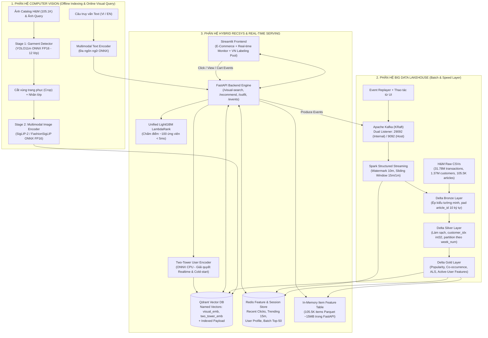

# KIẾN TRÚC HỆ THỐNG CHI TIẾT (SYSTEM ARCHITECTURE v3)

> **Phiên bản:** v3.0 (Production-Ready cho Laptop RTX 4060 8GB VRAM, 24GB RAM + Colab Pro+)  
> **Tài liệu liên quan:** [`docs/DATA_CONTRACTS.md`](file:///D:/G/BT,BTL,NCKH/BTL/BTL%20CV%20BigData/docs/DATA_CONTRACTS.md) · [`docs/MASTER_PLAN.md`](file:///D:/G/BT,BTL,NCKH/BTL/BTL%20CV%20BigData/docs/MASTER_PLAN.md) · [`docs/INFRA_AND_COLAB_GUIDE.md`](file:///D:/G/BT,BTL,NCKH/BTL/BTL%20CV%20BigData/docs/INFRA_AND_COLAB_GUIDE.md)

---

## 1. Sơ đồ Kiến trúc Tổng thể (End-to-End Architecture)

Hệ thống kết hợp **Kiến trúc Medallion Lakehouse + Lambda (Batch & Speed Layer)** cho môn Big Data, **Pipeline Thị giác Máy tính 2 Tầng (Detection $\rightarrow$ Multimodal Embedding)** cho môn Computer Vision, và **Kiến trúc Gợi ý Đa Tầng (Multi-Source Retrieval $\rightarrow$ LightGBM LambdaRank)** cho Hệ thống Gợi ý.

---

## 2. Thiết kế Chi tiết Từng Phân hệ

### 2.1. Phân hệ 1: Big Data Lakehouse & Stream Processing

#### A. Kiến trúc Medallion trên Delta Lake (`spark_jobs/batch/`)
Để tối ưu hóa hiệu năng I/O trên máy cá nhân 24GB RAM, hệ thống sử dụng **Delta Lake trên Local/WSL2 NVMe Filesystem** làm mặc định (và hỗ trợ chuyển sang **MinIO S3 `s3a://`** qua cấu hình `configs/paths.yaml` khi chạy bài đo so sánh lưu trữ):

1. **Tầng Bronze (`data/lakehouse/bronze/`):**
   - Job `b0_ingest_bronze.py` đọc 3 file CSV gốc với `StructType` khai báo tường minh (tuyệt đối không dùng `inferSchema`).
   - Chuẩn hóa `article_id` bằng `lpad(col("article_id"), 10, "0")` để giữ số `0` ở đầu.
   - Ghi nhận thêm luồng sự kiện thô từ Kafka thông qua job streaming `s1_bronze_sink`.
2. **Tầng Silver (`data/lakehouse/silver/`):**
   - Job `b1_clean_silver.py` thực hiện làm sạch giá trị thiếu (`age`, `club_member_status`, `detail_desc`), tạo bảng ánh xạ `customer_mapping` chuyển `customer_id` (64-char hex) sang `customer_idx` (`int32`, từ `0` đến `1.371.979`).
   - Tính cột `week_num` (số thứ tự tuần tính từ đầu tập dữ liệu, trong đó tuần cuối cùng `2020-09-16` $\rightarrow$ `2020-09-22` có `week_num = 104`).
   - Phân vùng bảng giao dịch theo `week_num` (`partitionBy("week_num")`) và chạy `OPTIMIZE ... ZORDER BY (customer_idx, article_id)`.
3. **Tầng Gold (`data/lakehouse/gold/`):**
   - **`gold/popularity` (`b3_popularity.py`):** Điểm phổ biến toàn cục và theo 4 nhóm tuổi (`16-22`, `23-30`, `31-45`, `46+`) có trọng số suy giảm hàm mũ theo ngày $w = \exp(-\lambda \cdot \Delta \text{days})$.
   - **`gold/cooccurrence` (`b4_cooccurrence.py`):** Ma trận đồng xuất hiện theo giỏ hàng `(customer_idx, t_dat)`. Xử lý bài toán lệch dữ liệu (**Data Skew**) bằng cách giới hạn giỏ hàng tối đa 30 món (tránh tài khoản mua buôn làm bùng nổ tích Descartes $N^2$) và chuẩn hóa theo chỉ số **Lift / Cosine**. Chia thành 2 bảng: *Cùng/Mọi nhóm* (cho RecSys) và *Khác nhóm trang phục* (cho gợi ý phối đồ `/outfit`).
   - **`gold/als_factors` (`b5_als.py`):** Vector ẩn của User và Item từ mô hình **Spark MLlib Implicit ALS** (`rank=64`).
   - **`gold/ranker_dataset` (`b6_candidates.py` & `b7_features.py`):** Bảng ứng viên và ~25 đặc trưng cho các `Active Users` trong tuần nhãn.

#### B. Tầng Xử lý Luồng Thời gian thực (`src/streaming/` & `spark_jobs/streaming/`)
- **Nguồn sự kiện trung thực:**
  1. `event_simulator.py`: Phát lại (replay) các giao dịch trong tuần kiểm định theo đúng thứ tự ngày `t_dat` (giờ/phút/giây trong ngày được sinh ngẫu nhiên đều và gắn nhãn `"source": "replay"`).
  2. Tương tác thật từ giao diện Streamlit (`view`, `click`, `add_to_cart`, `purchase`) gắn nhãn `"source": "ui"`.
- **Spark Structured Streaming (`s1_stream_processor.py`):**
  - Đọc từ topic `fashion-events` trên Kafka KRaft.
  - Áp dụng `withWatermark("event_time", "10 minutes")` và cửa sổ trượt `window("event_time", "15 minutes", "1 minute")` để tính **Real-time Trending Score**.
  - Ghi xuống Redis qua `foreachBatch` (sử dụng Redis Pipeline để đạt thông lượng hàng nghìn events/giây): cập nhật `trend:15m`, `trend:15m:{product_group}`, danh sách `user:{id}:recent` (tối đa 50 món gần nhất) và các chỉ số KPI.

---

### 2.2. Phân hệ 2: Computer Vision Pipeline (`src/cv/`)

1. **Stage 1 — Phát hiện và Cắt vùng Trang phục (Garment Detection):**
   - Huấn luyện trên tập **Fashionpedia** đã ánh xạ từ 46 lớp gốc về **12 lớp cốt lõi** (xem chi tiết tại [`configs/class_mapping.yaml`](file:///D:/G/BT,BTL,NCKH/BTL/BTL%20CV%20BigData/configs/class_mapping.yaml)): `top`, `outerwear`, `pants`, `shorts`, `skirt`, `dress`, `shoe`, `bag`, `hat`, `eyewear`, `scarf_tie`, `belt` (loại bỏ các lớp chi tiết bộ phận như cổ áo, tay áo, khóa kéo).
   - So sánh định lượng giữa **Detector Zero-shot** (`YOLO-World`) và **Fine-tuned `YOLO11s/m`** về chỉ số `mAP@50`, `mAP@50-95` và tốc độ suy luận (`PyTorch` vs `ONNX FP16`).
2. **Stage 2 — Biểu diễn Đa phương thức (Multimodal Representation):**
   - Benchmark 3 mô hình Zero-shot trên tập Test H&M (chia theo `product_code` để không rò rỉ các màu của cùng một kiểu dáng): `CLIP ViT-B/32`, `SigLIP-2 Base (patch16-224, đa ngôn ngữ)`, và `Marqo-FashionSigLIP` / `FashionCLIP`.
   - Nếu vượt qua **Gate CV-1**, thực hiện Fine-tune bằng **LoRA (rank 8–16)** trên Colab L4 với kỹ thuật loại bỏ False Negatives cùng `product_code` trong batch và nội suy trọng số **WiSE-FT** ($\alpha \in \{0.3, 0.5, 0.7\}$) để giữ khả năng tổng quát hóa trên ảnh chụp đời thực.
3. **Stage 3 — Đánh chỉ mục Qdrant & Truy vấn kết hợp Ảnh + Text:**
   - Mỗi sản phẩm trong Qdrant lưu 2 vector có tên (**Named Vectors**):
     - `visual_emb` ($D=512$ hoặc $768$, chuẩn hóa $L_2$): phục vụ tìm kiếm thị giác và đa phương thức.
     - `two_tower_emb` ($D=64$, chuẩn hóa $L_2$): phục vụ truy hồi cá nhân hóa thời gian thực từ mạng Two-Tower.
   - Hỗ trợ tìm kiếm kết hợp ảnh + văn bản điều chỉnh (*Composed Image Retrieval*):
     $$\mathbf{v}_{\text{query}} = \text{normalize}\big(\alpha \cdot \mathbf{v}_{\text{img}} + (1 - \alpha) \cdot \mathbf{v}_{\text{text}}\big)$$
     kết hợp bộ lọc Payload (`product_type_name`, `colour_group_name`, `index_group_name`).

---

### 2.3. Phân hệ 3: Hệ thống Gợi ý Lai (Hybrid Two-Stage Recommendation Engine — `src/recsys/`)

Hệ thống được xây dựng theo **5 bậc tiến hóa (L0 $\rightarrow$ L4)**, trong đó các bậc trước vừa là mốc so sánh (baseline), vừa trở thành **nguồn sinh ứng viên (Candidate Generators)** cho bậc sau:

| Bậc | Tên phương pháp | Vai trò trong kiến trúc cuối |
| :--- | :--- | :--- |
| **L0** | **Time-Decayed Age Popularity** | Nguồn ứng viên xu hướng theo độ tuổi + Fallback cho khách hàng hoàn toàn mới (Cold-start User). |
| **L1** | **Repurchase + Basket Co-occurrence** | Hai nguồn ứng viên hành vi mạnh nhất trên H&M (mua lại món cũ & mua món thường phối cùng). |
| **L2** | **Spark MLlib Implicit ALS** | Nguồn ứng viên lọc cộng tác (Collaborative Filtering) nắm bắt sở thích ẩn dài hạn. |
| **L3** | **LightGBM LambdaRank (có Visual Feature)** | **Mô hình Xếp hạng Chính (Core Ranker)** chấm điểm ~100 ứng viên gộp từ mọi nguồn. Tích hợp đặc trưng thị giác `visual_affinity_score` tính nhanh trên GPU. |
| **L4** | **Two-Tower Neural Retrieval (với Visual Vector)** | Nguồn ứng viên học sâu + Điểm `tt_score` đưa vào LightGBM. Giải quyết triệt để **Cold-start Item** (nhờ nhánh Item Tower dùng vector ảnh CLIP/SigLIP) và **Cập nhật Realtime theo từng cú click** (nhờ nhánh User Tower đọc chuỗi 15 món gần nhất từ Redis). |

---

### 2.4. Phân hệ 4: Serving thống nhất & Giao diện Demo (`src/backend/` & `src/frontend/`)

- **FastAPI Backend (`src/backend/main.py`):**
  - Khi khởi động: Nạp các model ONNX (`YOLO11`, `Encoder`, `Two-Tower User Tower`), model `LightGBM`, và bảng `Item Features` (~15MB Parquet) vào RAM.
  - **Không tách rời model LightGBM offline và online:** Dùng chung 1 model LightGBM duy nhất cho cả đánh giá offline và suy luận online để loại bỏ hoàn toàn hiện tượng *Training-Serving Skew*.
- **Streamlit Frontend (`src/frontend/app.py`):**
  - **Tab 1 — Visual Search & Smart Outfit:** Tải ảnh đời thực $\rightarrow$ vẽ khung Bounding Box $\rightarrow$ chọn món đồ + nhập yêu cầu văn bản tùy chọn $\rightarrow$ hiển thị Top-12 sản phẩm cá nhân hóa kèm lý giải (SHAP / nguồn đóng góp) và gợi ý phối đồ (*Complete the Look*).
  - **Tab 2 — Personalized Home Feed (Realtime Session Demo):** Chọn khách hàng $\rightarrow$ xem gợi ý trang chủ $\rightarrow$ bấm click vào 2–3 sản phẩm bất kỳ $\rightarrow$ thấy danh sách gợi ý thay đổi tức thì nhờ Kafka $\rightarrow$ Redis Session $\rightarrow$ Two-Tower + LightGBM.
  - **Tab 3 — Lakehouse & Streaming Monitor:** Biểu đồ thông lượng Kafka/Spark Streaming, bảng xếp hạng Trending 15 phút qua và phân bổ kênh bán hàng.
  - **Tab 4 — VN Streetwear Pooled Labeling App:** Công cụ chấm điểm mù (0–3) đã gộp và khử trùng lặp ứng viên để tính `nDCG@10` và `Cohen's Kappa`.
