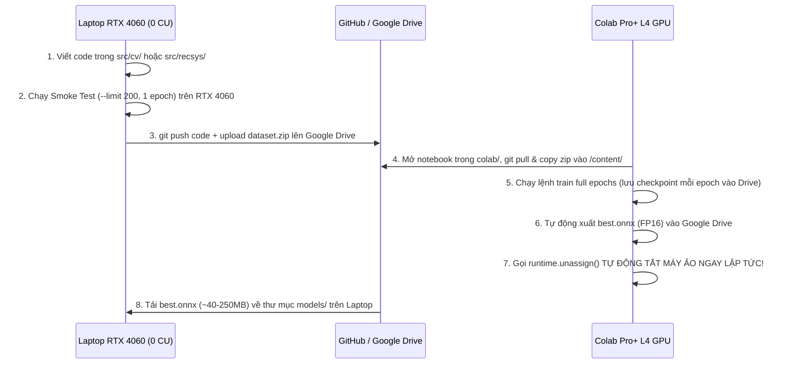

# CHIẾN LƯỢC HẠ TẦNG LAI (LAPTOP RTX 4060 $\leftrightarrow$ COLAB PRO+), XỬ LÝ MODEL LỚN & QUY TRÌNH KẾT NỐI

> **Mục đích tài liệu:** Giải đáp và chuẩn hóa toàn bộ quy trình vận hành phần cứng giữa **Máy cá nhân (Laptop RTX 4060 8GB VRAM, 24GB RAM)** và **Google Colab Pro+ (~200 Compute Units)**, cách đảm bảo mọi mô hình sau khi train đều chạy mượt trên máy cá nhân với độ trễ mili-giây, và phương thức kết nối tối ưu nhất.

---

## 1. Phân bổ Tài nguyên: Dùng Colab Pro+ ở đâu để không lãng phí Compute Units (CU)?

### 1.1. Hiểu đúng về cơ chế trừ tiền (CU) của Colab Pro+ và sức mạnh của RTX 4060
* **Cơ chế của Colab Pro+:** Compute Units (CU) bị trừ **theo từng phút ngay cả khi máy ảo đang rảnh (idle)**, chỉ cần Runtime đang kết nối là đồng hồ nhảy số:
  * **CPU High-RAM Runtime:** ~0.1 – 0.2 CU / giờ
  * **T4 GPU (16GB VRAM):** ~1.4 CU / giờ
  * **L4 GPU (24GB VRAM, kiến trúc Ada Lovelace):** ~2.2 – 2.8 CU / giờ *(Tỉ lệ hiệu năng/giá tốt nhất!)*
  * **A100 GPU (40GB/80GB VRAM):** ~11 – 15 CU / giờ *(Quá đắt và không cần thiết cho quy mô dữ liệu này)*
* **Sức mạnh của Laptop RTX 4060 (8GB VRAM) + 24GB RAM:**
  * RTX 4060 có cùng kiến trúc **Ada Lovelace** với GPU L4 trên Colab, hỗ trợ phần cứng cho **FP16, BF16, INT8 và TensorRT** cực mạnh, và đặc biệt là **tốn 0 CU**.
  * Do đó, **90% thời gian phát triển, xử lý dữ liệu Big Data, trích xuất vector và chạy hệ thống hoàn toàn nằm trên Laptop**.

### 1.2. Bảng Phân công Tác vụ: Local Laptop vs. Colab Pro+

| Tác vụ | Chạy ở đâu? | Cấu hình đề xuất | Thời gian dự kiến | Chi phí CU | Lý do kỹ thuật |
| :--- | :--- | :--- | :---: | :---: | :--- |
| **1. Tải & Resize bộ ảnh H&M gốc** *(nếu bản 256 bị méo tỉ lệ)* | **Colab Pro+** | **CPU Runtime** | ~30–45 phút | **~0.5 CU** | Mạng nội bộ Google tải từ Kaggle tốc độ 300MB/s (không tốn băng thông nhà bạn), nén lại thành file `.zip` chuẩn tỉ lệ lưu vào Google Drive. |
| **2. Viết code, Debug & Smoke Test (200 mẫu)** | **Laptop 4060** | Local GPU/CPU | Liên tục | **0 CU** | Tuyệt đối không mở GPU Colab để ngồi gõ code hay sửa lỗi cú pháp. |
| **3. Benchmark 3 model Zero-shot trên 105K ảnh** | **Laptop 4060** | Local GPU (FP16, batch 128) | ~6–10 phút / model | **0 CU** | Inference ở chế độ `torch.inference_mode()` + `fp16` chỉ tốn ~1.5GB VRAM. |
| **4. Huấn luyện Detector `YOLO11m` trên Fashionpedia (~45.6K ảnh)** | **Colab Pro+** | **L4 GPU (24GB)** | ~4–6 giờ | **~12–18 CU** | Train 50–80 epochs trên 45.6K ảnh với `batch=32, imgsz=640` trên L4 nhanh gấp 3 lần laptop và không làm nóng máy cá nhân. |
| **5. Fine-tune `SigLIP-2` / `CLIP` với LoRA** *(nếu qua Gate CV-1)* | **Colab Pro+** | **L4 GPU (24GB)** | ~1.5–2.5 giờ | **~5–8 CU** | Contrastive Loss (InfoNCE / Sigmoid) cần **batch size lớn (256–512)** để có nhiều negative samples trong batch $\rightarrow$ cần 24GB VRAM của L4. |
| **6. Toàn bộ PySpark Batch (`B0` $\rightarrow$ `B8`), ALS, LightGBM** | **Laptop CPU** | WSL2 (12–16GB RAM) | ~3–10 phút / job | **0 CU** | Đã tối ưu lọc `Active Users` (~70K khách/tuần $\rightarrow$ 7M dòng), chạy cực nhẹ trên CPU laptop. |
| **7. Tính Feature `Visual Affinity` (7M cặp)** | **Laptop 4060** | Local GPU (PyTorch) | **< 5 giây** | **0 CU** | Ma trận vector ảnh chỉ nặng 162MB, nhân ma trận trên RTX 4060 mất vài giây. |
| **8. Huấn luyện mạng `Two-Tower Neural Retrieval`** | **Laptop 4060** | Local GPU (FP16) | ~10–15 phút | **0 CU** | Đầu vào là vector ảnh đã đóng băng + ID embedding $\rightarrow$ chỉ tốn ~2.5GB VRAM. |
| **9. Serving (FastAPI + Qdrant + Redis + Kafka + UI)** | **Laptop 4060** | Docker + Local | Realtime | **0 CU** | Toàn bộ hệ thống demo chạy cục bộ, độ trễ < 100ms, không phụ thuộc mạng ngoài. |

> **Tổng ngân sách tiêu thụ dự kiến cả kỳ:** Chỉ khoảng **25 – 45 CU** (kể cả chạy lại 2–3 lần vẫn chưa hết 100 CU trên tổng số 200 CU bạn có!).

---

## 2. Giải quyết Bài toán: "Train model trên Colab xong mà mang về Laptop không chạy nổi vì Model quá lớn thì sao?"

Đây là rủi ro rất phổ biến khi sinh viên train model trên GPU 24GB/40GB của Colab rồi mang về máy cá nhân 8GB VRAM (nơi phải chạy cùng lúc cả hệ điều hành Windows, trình duyệt, Docker, Qdrant, Spark và FastAPI).

Để **ĐẢM BẢO 100% không bao giờ xảy ra tình trạng model quá lớn không chạy được trên Laptop RTX 4060**, dự án áp dụng **5 Lớp Phòng Vệ Kỹ Thuật (5-Layer Model Fitting Strategy)**:

### Lớp 1: Chốt kích thước Backbone "Vừa vặn" ngay từ thiết kế (Right-Sizing Architecture)
* Không bao giờ chọn các backbone khổng lồ mang tính phô trương nhưng không tăng nhiều độ chính xác trên H&M như `ViT-Huge`, `SigLIP-SO400M`, `EVA-02-Large` hay `YOLO11x`.
* Trong [`configs/model_config.yaml`](file:///D:/G/BT,BTL,NCKH/BTL/BTL%20CV%20BigData/configs/model_config.yaml), chúng ta khóa cứng kích thước mô hình ở ngưỡng tối ưu cho RTX 4060:
  * **Detector:** `YOLO11s` (9.4M params) hoặc `YOLO11m` (20.1M params).
  * **Multimodal Encoder:** `SigLIP-2 Base (ViT-B/16)` hoặc `CLIP ViT-B/32` (~86M params cho nhánh ảnh, ~65M params cho nhánh text).
  * **Two-Tower User Encoder:** MLP + 1 lớp Attention nhẹ (~2M params).
  * **Ranker:** `LightGBM` (chạy trên CPU, ~15MB).

### Lớp 2: Gộp LoRA + Cắt bỏ Optimizer State + Xuất sang ONNX FP16/INT8 ngay trên Colab
* **Tại sao file checkpoint trên Colab thường rất nặng?**
  Khi đang train bằng `AdamW`, file `.pt` lưu cả: (1) Trọng số gốc `FP32` (4 bytes/param), (2) Граdient `FP32`, (3) Momentum state `FP32` và (4) Variance state `FP32` $\rightarrow$ dung lượng phình gấp **4 lần**!
* **Quy trình bắt buộc ở bước cuối trên Colab (trước khi tải về máy cá nhân):**
  1. Nếu dùng LoRA: Gọi `model = model.merge_and_unload()` để cộng thẳng ma trận LoRA $\Delta W = B \cdot A$ vào trọng số gốc $W_0$ (nhờ đó khi chạy ở máy cá nhân không tốn thêm bất kỳ phép nhân ma trận phụ nào).
  2. Chuyển sang chế độ `model.eval().half()` (**FP16** — giảm ngay 50% dung lượng và VRAM).
  3. Xuất thẳng ra định dạng **ONNX Runtime (`.onnx` FP16)** hoặc **INT8 Quantization** bằng script [`src/cv/export_onnx.py`](file:///D:/G/BT,BTL,NCKH/BTL/BTL%20CV%20BigData/src/cv/export_onnx.py).

**Bảng tính toán VRAM thực tế khi chạy đồng thời TẤT CẢ các mô hình trong FastAPI trên RTX 4060 (8.192 MB VRAM):**

| Mô hình trong FastAPI | Định dạng khi chạy Local | Thiết bị | VRAM tiêu thụ | Độ trễ 1 lần gọi |
| :--- | :--- | :---: | :---: | :---: |
| `YOLO11m` (12 lớp thời trang) | ONNX Runtime (`FP16`) | **GPU (RTX 4060)** | **~180 MB** | ~8 – 15 ms |
| `SigLIP-2 / CLIP Vision Encoder` | ONNX Runtime (`FP16`) | **GPU (RTX 4060)** | **~260 MB** | ~6 – 12 ms |
| `SigLIP-2 / CLIP Text Encoder` | ONNX Runtime (`FP16` / `INT8`) | **CPU hoặc GPU** | **~0 – 180 MB** | ~5 – 10 ms |
| `Two-Tower User Tower` | ONNX Runtime (`FP32`) | **CPU** | **0 MB VRAM** | ~1 – 2 ms |
| `LightGBM LambdaRank` | Native C++ Booster | **CPU** | **0 MB VRAM** | ~3 – 5 ms |
| CUDA Context & Buffer Overhead | — | **GPU (RTX 4060)** | **~450 MB** | — |
| **TỔNG CỘNG TOÀN BỘ BACKEND** | | | **~900 MB – 1.1 GB VRAM** | **< 45 ms tổng** |

> **Kết luận:** Toàn bộ dàn model AI khi chạy ở chuẩn ONNX FP16 chỉ chiếm **~1.1 GB trên tổng số 8.0 GB VRAM** của RTX 4060! Bạn còn dư gần **7 GB VRAM** hoàn toàn thoải mái.

### Lớp 3: Tách Thiết bị Thông minh (Smart Device Placement: GPU vs. CPU)
* Trên máy cá nhân, bạn có **CPU đa nhân + 24GB RAM** rất khỏe.
* Chỉ những tác vụ xử lý ma trận điểm ảnh 2D nặng (`YOLO11 Detector` và `Vision Encoder`) mới đặt trên **GPU RTX 4060** (`CUDAExecutionProvider`).
* Các mô hình xử lý chuỗi ngắn hoặc bảng chỉ chạy 1 mẫu mỗi request (`Text Encoder`, `Two-Tower User Encoder`, `LightGBM Ranker`) được cấu hình chạy trên **CPU (`CPUExecutionProvider`)** $\rightarrow$ vừa có độ trễ dưới 5ms, vừa không tốn 1 byte VRAM nào!

### Lớp 4: Tính toán Trước (Offline Pre-computation)
* Khi người dùng tìm kiếm trên 105.100 sản phẩm H&M, máy cá nhân của bạn **KHÔNG** chạy model trên 105.100 ảnh đó lúc người dùng bấm nút!
* Toàn bộ 105.100 vector ảnh (`visual_emb`) và 105.100 vector sản phẩm (`two_tower_emb`) đã được trích xuất **1 lần duy nhất** và lưu trong **Qdrant**. Lúc chạy thật, GPU của bạn chỉ phải xử lý **đúng 1 bức ảnh** người dùng vừa tải lên.

### Lớp 5: Phương án Dự phòng nếu Bạn muốn thử một Model "Khổng lồ" (Knowledge Distillation / Offloading)
* Giả sử trong quá trình nghiên cứu mở rộng, bạn muốn thử một mô hình cực lớn trên Colab (ví dụ: `GroundingDINO-Large` hoặc `SigLIP-SO400M-384`):
  * **Cách A (Khuyên dùng cho CV):** Chạy model lớn trên Colab để trích xuất sẵn 105.100 vector hoặc gán nhãn giả (Pseudo-labeling), sau đó **chưng cất (Distill)** đầu ra của nó sang một mạng chiếu nhỏ (`Linear/MLP Adapter`) hoặc `YOLO11s` chạy nhẹ nhàng trên máy cá nhân.
  * **Cách B (Cho trường hợp chỉ chạy đánh giá Batch):** Trích xuất toàn bộ vector của cả tập Catalog lẫn tập Query ngay trên Colab L4, lưu thành file `.parquet` (~150MB) rồi tải file `.parquet` đó về máy cá nhân để nạp vào Qdrant.

---

## 3. Có nên dùng SSH vào Colab Pro+ không? Kết nối như thế nào và ở đâu là chuẩn nhất?

### 3.1. Tại sao KHÔNG NÊN dùng SSH truyền thống (`ngrok` / `colab-ssh`) làm luồng làm việc chính?
Nhiều bạn mới dùng Colab Pro thường tìm cách cài `openssh-server` + `ngrok` để mở VS Code từ máy cá nhân SSH thẳng vào máy ảo Colab ngồi code. **Cách này có 3 nhược điểm rất lớn:**
1. **Đốt sạch Compute Units (CU) khi đang suy nghĩ và gõ code:** Khi bạn SSH vào GPU L4/A100 để đọc file, sửa lỗi, suy nghĩ thuật toán trong 4 tiếng, bạn mất không **10 – 50 CU** chỉ để làm công việc mà máy cá nhân của bạn làm miễn phí và mượt hơn nhiều!
2. **Vi phạm chính sách & hay bị ngắt đột ngột:** Google Colab quét các tiến trình tạo SSH daemon ngầm (`sshd` qua `ngrok` / `localtunnel`). Khi kết nối SSH bị đứt giữa chừng, tiến trình huấn luyện chạy trong terminal SSH có thể bị nhận tín hiệu `SIGHUP` và **chết ngay lập tức ở epoch 49/50**!
3. **Mất toàn bộ dữ liệu ngoài Google Drive khi Runtime hết hạn:** Mọi file code bạn sửa trực tiếp trên ổ `/content` của Colab qua SSH sẽ biến mất hoàn toàn khi Colab thu hồi máy ảo.

### 3.2. Quy trình Kết nối Chuẩn Công nghiệp: "Code & Smoke-Test Local $\rightarrow$ Git/Drive $\rightarrow$ Colab CLI Execution + Auto-Shutdown"

Đây là quy trình được thiết kế sẵn trong thư mục [`colab/`](file:///D:/G/BT,BTL,NCKH/BTL/BTL%20CV%20BigData/colab/) của codebase này:



#### Điểm ăn tiền nhất của quy trình này: Lệnh "Tự Động Ngắt Runtime" bảo vệ ví CU của bạn
Ở dòng cuối cùng của mọi script/notebook chạy trên Colab trong dự án này luôn có khối lệnh `try ... finally`:

```python
import shutil
from google.colab import runtime

try:
    # 1. Chạy huấn luyện và lưu checkpoint trực tiếp vào Google Drive
    train_model(save_dir="/content/drive/MyDrive/btl_cv_bigdata/checkpoints")
    # 2. Xuất sang ONNX FP16 gọn nhẹ để mang về Laptop RTX 4060
    export_to_onnx_fp16(output_path="/content/drive/MyDrive/btl_cv_bigdata/models/best_fp16.onnx")
finally:
    # 3. Tự động trả máy ảo ngay khi train xong (hoặc khi gặp lỗi) -> KHÔNG BAO GIỜ TỐN CU THỪA!
    print("Training finished. Releasing Colab runtime to save Compute Units...")
    runtime.unassign()
```
Nhờ khối lệnh này, bạn có thể bấm chạy lúc 11 giờ đêm rồi đi ngủ: giả sử 2 giờ sáng train xong, Colab tự động lưu model vào Drive và **tự tắt máy ảo ngay lúc 2 giờ sáng**, không bị trừ oan CU từ 2 giờ sáng đến 8 giờ sáng!

### 3.3. Khi nào THÌ DÙNG kết nối trực tiếp từ VS Code vào Colab và cài đặt như thế nào?

Nếu có một lỗi đặc thù chỉ xảy ra trên môi trường Colab L4 mà bạn cần mở Terminal / VS Code gắn trực tiếp vào máy ảo Colab để kiểm tra nhanh trong 15–30 phút, hãy dùng **1 trong 2 cách an toàn sau**:

#### Cách A (Chính thống, không cần SSH): Dùng tính năng Colab Terminal hoặc VS Code Colab Extension
* Với gói **Colab Pro+**, giao diện web của Google Colab đã tích hợp sẵn **Nút Terminal (`>_`) ở góc dưới bên trái**. Bạn có thể mở bash shell trực tiếp trên trình duyệt cực kỳ ổn định mà không sợ bị Google khóa tài khoản.

#### Cách B (Nếu muốn kết nối bằng VS Code Remote-SSH từ Laptop của bạn): Dùng Cloudflare Tunnel (`cloudflared`)
Không dùng `ngrok` (bị giới hạn băng thông và hay bị chặn). Hãy chạy đoạn mã sau trong 1 cell trên Colab khi cần mở cổng SSH tạm thời qua **Cloudflare Argo Tunnel**:

```bash
# Chạy trên Cell của Colab Pro+ khi cần debug qua VS Code Remote-SSH
!apt-get install -qq -o=Dpkg::Use-Pty=0 openssh-server pwgen > /dev/null
!wget -q -nc https://github.com/cloudflare/cloudflared/releases/latest/download/cloudflared-linux-amd64.deb
!dpkg -i cloudflared-linux-amd64.deb > /dev/null

# Đặt mật khẩu root hoặc thêm SSH public key của bạn
!echo root:YourStrongPassword123 | chpasswd
!mkdir -p /var/run/sshd
!echo "PermitRootLogin yes" >> /etc/ssh/sshd_config
!echo "PasswordAuthentication yes" >> /etc/ssh/sshd_config
!/usr/sbin/sshd

# Tạo đường hầm SSH qua Cloudflare
!cloudflared tunnel --url ssh://localhost:22 --logfile /content/cf.log &
!sleep 5 && grep -o 'https://.*\.trycloudflare\.com' /content/cf.log
```

**Trên Laptop cá nhân của bạn (`C:\Users\Lenovo\.ssh\config` hoặc `~/.ssh/config` trong WSL2):**
1. Tải `cloudflared` về máy cá nhân (`winget install Cloudflare.cloudflared` trên Windows hoặc `sudo apt install cloudflared` trên WSL2).
2. Thêm cấu hình vào file `.ssh/config`:
   ```sshconfig
   Host colab-gpu
       HostName <dán-tên-miền-trycloudflare-vừa-in-ra-không-có-https>
       User root
       ProxyCommand cloudflared access ssh --hostname %h
       StrictHostKeyChecking no
   ```
3. Mở VS Code $\rightarrow$ `Remote-SSH: Connect to Host...` $\rightarrow$ chọn `colab-gpu`.
4. **Quy tắc bắt buộc:** Ngay sau khi debug xong trên SSH, phải tắt Runtime ngay để không đốt CU!

---

## 4. Quy tắc Vàng về I/O trên Google Colab (Tránh làm chậm tốc độ Train 20 lần)

Khi huấn luyện `YOLO11m` (45.600 ảnh Fashionpedia) hoặc `SigLIP-2` (105.100 ảnh H&M) trên Colab:
* ❌ **SAI LẦM PHỔ BIẾN:** Đặt45.600 file ảnh rời rạc trong `/content/drive/MyDrive/dataset/images/` rồi trỏ thẳng DataLoader đọc từ đường dẫn `/content/drive/...`. Vì Google Drive mount qua mạng (FUSE), việc mở hàng chục nghìn file nhỏ sẽ làm GPU L4 nằm chờ đĩa 95% thời gian (GPU Utilization = 5%), 1 epoch mất 30 phút thay vì 1 phút!
* ✅ **CÁCH LÀM ĐÚNG (Bắt buộc áp dụng):**
  1. Lưu toàn bộ dataset trên Google Drive dưới dạng **1 file nén duy nhất** (`fashionpedia_yolo.tar` hoặc `hm256_padded.tar` — dùng `.tar` không nén hoặc `.zip` để bung cực nhanh).
  2. Ở đầu phiên chạy Colab, copy 1 file duy nhất đó vào ổ SSD NVMe nội bộ của máy ảo Colab (`/content/local_data/`) rồi giải nén tại `/content/local_data/`:
     ```bash
     mkdir -p /content/local_data
     cp /content/drive/MyDrive/btl_cv_bigdata/datasets/fashionpedia_yolo.tar /content/local_data/
     tar -xf /content/local_data/fashionpedia_yolo.tar -C /content/local_data/
     ```
  3. Trỏ `DataLoader` vào `/content/local_data/...` (tốc độ đọc ~2.000 MB/s), và chỉ lưu **file trọng số `.pt` / `.onnx`** ngược về `/content/drive/MyDrive/...`.
