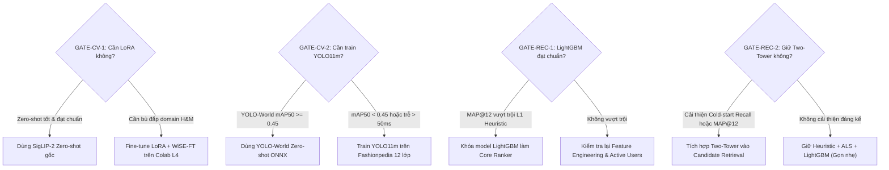

# KẾ HOẠCH THỰC THI TỔNG THỂ (MASTER PLAN v3 — PRODUCTION-READY)

> **Tài liệu trung tâm:** Kế hoạch 6 Work Packages (`WP-0` $\rightarrow$ `WP-6`), danh mục nhiệm vụ chi tiết (`TASK-xx`), tiêu chí nghiệm thu (Acceptance Criteria) và điều kiện qua cổng (Decision Gates).
> **Tài liệu liên quan:**
> - Bảng theo dõi tiến độ thời gian thực: [`STATE.md`](STATE.md)
> - Kiến trúc kỹ thuật chi tiết: [`ARCHITECTURE.md`](ARCHITECTURE.md)
> - Đặc tả dữ liệu & Data Contracts: [`DATA_CONTRACTS.md`](DATA_CONTRACTS.md)
> - Hướng dẫn hạ tầng & Colab: [`INFRA_AND_COLAB_GUIDE.md`](INFRA_AND_COLAB_GUIDE.md)
> - Quy tắc điều phối & 8 quy tắc vàng: [`../AGENTS.md`](../AGENTS.md)

---

## 1. Triết lý Thiết kế: Baseline-First & Decision Gates

Hệ thống được phát triển theo 3 nguyên tắc nền tảng:
1. **Tuần 1 có ngay hệ thống End-to-End hoạt động (Baseline v0):**
   - Computer Vision: Trích xuất vector catalog H&M bằng Zero-shot model mạnh nhất (`SigLIP-2` / `FashionSigLIP` / `CLIP`) và nạp vào Qdrant.
   - RecSys: Triển khai các baseline Heuristic vững chắc (Popularity suy giảm theo thời gian, Repurchase, Item Co-occurrence) để tạo ngưỡng so sánh (`MAP@12`).
   - Serving: Dựng khung FastAPI kết nối Qdrant và phục vụ truy vấn tìm kiếm trang phục.
2. **Không huấn luyện nếu không vượt qua Decision Gate:**
   - Mọi nỗ lực Fine-tune (YOLO11, LoRA) và Deep Learning (Two-Tower) chỉ được kích hoạt khi baseline không đạt chuẩn hoặc thí nghiệm chứng minh sự vượt trội rõ rệt.
3. **Chống rò rỉ dữ liệu & bảo vệ tài nguyên:**
   - Cố định tuần kiểm định (Validation Week): **`2020-09-16` đến `2020-09-22`** (Tuần 104).
   - Tuyệt đối không dùng dữ liệu tương lai để tính feature (`t_dat < t_start`).
   - Active-User Filtering: Chỉ tạo tập huấn luyện LightGBM trên khách hàng thực sự mua hàng trong tuần nhãn (~70K khách $\times$ 100 ứng viên $\approx$ 7M dòng), giữ bộ nhớ trong giới hạn an toàn 24GB RAM.

---

## 2. Danh Mục Work Packages & Nhiệm Vụ Chi Tiết

### WP-0: Khởi tạo Hạ tầng, Codebase & Kiểm định Dữ liệu (Tuần 1)

* **`TASK-00`: Khởi tạo Codebase, Contracts, Configs & Unit Tests**
  - **Mục tiêu:** Thiết lập cấu trúc repo chuẩn, hợp đồng dữ liệu Pydantic, bộ metric không thiên vị (`MAP@12`, `nDCG@10`, `Cohen's Kappa`) và hàm chuẩn hóa `article_id`.
  - **Đầu ra:** Toàn bộ thư mục khung, unit tests chạy pass `pytest tests/test_metrics_and_ids.py`.
  - **Tiêu chí nghiệm thu:** `tests/` pass 100%, bảo toàn mã 10 ký tự `article_id`.

* **`TASK-01`: Dựng Hạ tầng Dịch vụ Docker Compose**
  - **Mục tiêu:** Khởi động Qdrant Vector DB, Redis Cluster/Single-node, Kafka KRaft với cấu hình Dual-Listener (`INTERNAL://kafka:29092`, `EXTERNAL://localhost:9092`).
  - **Đầu ra:** `docker-compose.yml` hoạt động ổn định.
  - **Tiêu chí nghiệm thu:** Kết nối thông suốt cả trong container lẫn từ máy host qua cổng `9092`, `6333`, `6379`.

* **`TASK-02`: Tải Dataset & Kiểm định Tỉ lệ Ảnh (Aspect Ratio)**
  - **Mục tiêu:** Tải dataset H&M và Fashionpedia vào `data/raw/`. Kiểm tra xem ảnh `hm256x256` có bị bóp méo khung hình hay không bằng script [`../scripts/check_hm256_aspect_ratio.py`](../scripts/check_hm256_aspect_ratio.py).
  - **Đầu ra:** File báo cáo `reports/tables/hm256_aspect_check.json`.
  - **Tiêu chí nghiệm thu:** Nếu phát hiện méo ảnh, chạy [`../scripts/resize_hm_aspect_pad.py`](../scripts/resize_hm_aspect_pad.py) để pad viền giữ nguyên tỉ lệ gốc.

---

### WP-1: Baseline Hệ thống & Xử lý Dữ liệu Lakehouse (Tuần 1 - 2)

* **`TASK-BD-01`: PySpark Batch Pipeline (Bronze $\rightarrow$ Silver Delta Lake)**
  - **Mục tiêu:** Ingest dữ liệu CSV H&M vào Bronze Delta Lake; làm sạch, ép kiểu `article_id` `StringType(10)`, ánh xạ `customer_id` sang `customer_idx` (`int32`), lưu bảng Silver partitioned theo `t_dat`.
  - **Đầu ra:** `spark_jobs/batch/b0_ingest_bronze.py`, `spark_jobs/batch/b1_clean_silver.py`.
  - **Tiêu chí nghiệm thu:** Benchmark dung lượng lưu trữ (`CSV` vs `Parquet` vs `Delta`) lưu vào `reports/tables/storage_benchmark.json`.

* **`TASK-BD-02`: EDA Big Data & Phân tích Hành vi Mua sắm**
  - **Mục tiêu:** Dùng PySpark phân tích phân phối Long-tail, tỉ lệ Repurchase theo ngành hàng, độ trễ giữa các lần mua và tỉ lệ khách hàng Cold-start.
  - **Đầu ra:** Script `spark_jobs/batch/b2_eda_stats.py`, bảng thống kê lưu tại `reports/tables/eda_summary.json`.

* **`TASK-REC-01`: Khung Đánh giá Tuần 104 & RecSys Baselines L0 + L1**
  - **Mục tiêu:** Xây dựng module đánh giá chuẩn thời gian (Validation Week 104). Cài đặt Baseline **L0** (Global & Age-group Popularity suy giảm theo thời gian $\alpha = 0.8$) và **L1** (Cá nhân hóa Heuristic: Repurchase gần nhất + Item Co-occurrence).
  - **Đầu ra:** `src/recsys/baselines.py`, bảng so sánh `MAP@12` tại `reports/tables/recsys_baselines_val.json`.
  - **Tiêu chí nghiệm thu:** Điểm `MAP@12` của L0 và L1 được ghi nhận đầy đủ, không rò rỉ dữ liệu sau ngày `2020-09-15`.

* **`TASK-CV-01`: Phân chia H&M Split theo `product_code`**
  - **Mục tiêu:** Chia 105.542 sản phẩm thành Train (85%), Val (7.5%), Test (7.5%) theo nhóm `product_code` để chống rò rỉ kiểu dáng giữa các tập.
  - **Đầu ra:** `src/cv/split_data.py`, file danh sách `data/splits/product_splits.json`.

* **`TASK-CV-02`: Benchmark Zero-shot Multimodal Embeddings (`GATE-CV-1`)**
  - **Mục tiêu:** Đánh giá 3 mô hình Zero-shot (`openai/clip-vit-base-patch32`, `google/siglip2-base-patch16-224`, `Marqo/marqo-fashionSigLIP`) trên tập Val H&M theo 2 tác vụ: Text-to-Image Retrieval (`T2I R@10`) và Image-to-Image Precision (`I2I P@10-type+colour`).
  - **Đầu ra:** Bảng kết quả `reports/tables/cv_zeroshot_benchmark.json`.
  - **Tiêu chí nghiệm thu:** Chọn ra model tốt nhất làm nền tảng cho Qdrant Indexer; đánh giá điều kiện mở cổng `GATE-CV-1`.

* **`TASK-CV-03`: Đánh chỉ mục Qdrant Catalog & Benchmark Quantization**
  - **Mục tiêu:** Trích xuất vector cho 105.1K ảnh bằng model tốt nhất từ `TASK-CV-02`, nạp vào Qdrant với payload phong phú (`article_id`, `product_type_name`, `colour_group_name`, `price`). Benchmark tốc độ truy vấn và dung lượng RAM giữa `FP32` và `INT8 Scalar Quantization`.
  - **Đầu ra:** `src/cv/qdrant_indexer.py`, bảng benchmark tại `reports/tables/qdrant_benchmark.json`.
  - **Tiêu chí nghiệm thu:** Độ trễ tìm kiếm Top-10 vector < 15ms.

---

### WP-2: Nâng cấp Computer Vision & Đánh giá 3 Tầng (Tuần 3)

* **`TASK-CV-04A`: Chuẩn bị Dữ liệu Fashionpedia 12 Lớp & Đánh giá Zero-shot Detector**
  - **Mục tiêu:** Ánh xạ 46 lớp Fashionpedia về 12 lớp cốt lõi thời trang theo [`../configs/class_mapping.yaml`](../configs/class_mapping.yaml). Đánh giá detector zero-shot (`YOLO-World`) trên tập val Fashionpedia để kiểm tra `GATE-CV-2`.
  - **Đầu ra:** `src/cv/prepare_fashionpedia.py`, file kết quả `reports/tables/detector_zeroshot_eval.json`.

* **`TASK-CV-04B`: Huấn luyện YOLO11m trên Fashionpedia & Xuất ONNX FP16**
  - **Mục tiêu:** Nếu `GATE-CV-2` kích hoạt, huấn luyện `YOLO11m` trên Colab L4 (~12-18 CU) trên 12 lớp thời trang. Xuất model sang chuẩn ONNX FP16 tối ưu cho CPU/GPU Serving.
  - **Đầu ra:** `colab/train_yolo11_fashionpedia.ipynb`, script `src/cv/export_onnx.py`, model `models/yolo11m_fashion12.onnx`.
  - **Tiêu chí nghiệm thu:** `mAP@50 > 0.50`, độ trễ inference < 30ms trên RTX 4060.

* **`TASK-CV-05`: (Có điều kiện) Fine-tune Multimodal Encoder với LoRA + WiSE-FT**
  - **Mục tiêu:** Nếu `GATE-CV-1` kích hoạt, fine-tune adapter LoRA (Rank 16, Alpha 32) cho nhánh Vision/Text trên Colab L4. Áp dụng kỹ thuật nội suy trọng số **WiSE-FT** ($\alpha = 0.5$) để giữ vững năng lực khái quát hóa trên ảnh chụp đường phố thực tế.
  - **Đầu ra:** `colab/train_siglip_lora.ipynb`, checkpoint adapter `models/lora_adapter/`.

* **`TASK-CV-06`: Đánh giá Toàn diện 3 Tầng (Proxy & Việt Nam Street Set)**
  - **Mục tiêu:**
    1. Tầng B: Đánh giá `CatConsistency@10` tự động trên crop từ tập val Fashionpedia.
    2. Tầng C: Thu thập 50 ảnh chụp trang phục đời thường tại Việt Nam, chạy qua detector + search, dùng giao diện Streamlit Labeling Tool để 2 người gán nhãn chéo độc lập (thang 0–3), tính `nDCG@10` và hệ số đồng thuận `Cohen's Kappa`.
  - **Đầu ra:** `src/metrics/cv_metrics.py`, bảng kết quả `reports/tables/cv_3tier_evaluation.json`.

---

### WP-3: Mô hình Hóa RecSys — Spark ALS & LightGBM LambdaRank (Tuần 3 - 4)

* **`TASK-REC-02`: Huấn luyện Spark MLlib Implicit ALS (Baseline L2)**
  - **Mục tiêu:** Huấn luyện mô hình Collaborative Filtering phân tán Implicit ALS trên PySpark với trọng số tương tác suy giảm theo thời gian ($c_{ui} = 1 + \alpha r_{ui} \cdot e^{-\lambda \Delta t}$).
  - **Đầu ra:** `spark_jobs/batch/b5_als_model.py`, lưu ứng viên ALS vào `silver/candidates_als`.
  - **Tiêu chí nghiệm thu:** Đo `Candidate Recall@100` và `MAP@12` trên Validation Week 104.

* **`TASK-REC-03`: Sinh Ứng Viên Active Users & Tính Feature GPU**
  - **Mục tiêu:** Sinh 100 ứng viên từ đa nguồn (Popularity + Repurchase + Co-occurrence + ALS) cho ~70.000 khách hàng hoạt động trong tuần nhãn. Dùng PyTorch GPU (`src/recsys/features_gpu.py`) tính vector thị giác trung bình của khách hàng và độ tương đồng `visual_affinity_score` với từng ứng viên (< 3 giây cho 7M dòng).
  - **Đầu ra:** Bảng huấn luyện hoàn chỉnh `silver/lgbm_train_features` (~7M dòng $\times$ 45 cột).
  - **Tiêu chí nghiệm thu:** Hoàn thành trong < 10 phút, không vượt quá 8GB RAM hệ thống.

* **`TASK-REC-04`: Huấn luyện LightGBM LambdaRank (L3) & Phân tích SHAP**
  - **Mục tiêu:** Huấn luyện LightGBM Objective `lambdarank` tối ưu `ndcg_eval`, đánh giá `MAP@12` trên Tuần 104 (`GATE-REC-1`). Phân tích mức độ đóng góp của các nhóm feature (Lịch sử, Giá, Thị giác, Co-occurrence) bằng SHAP Summary Plot.
  - **Đầu ra:** `src/recsys/lgbm_ranker.py`, model file `models/lgbm_ranker.txt`, đồ thị `reports/figures/lgbm_shap_summary.png`.
  - **Tiêu chí nghiệm thu:** `MAP@12` của L3 phải vượt trội baseline L1 và L2; số liệu ghi vào `reports/tables/recsys_lgbm_eval.json`.

---

### WP-4: Deep Retrieval Two-Tower & Visual Fusion (Tuần 4 - 5)

* **`TASK-REC-05`: Thiết kế & Huấn luyện Mạng Two-Tower (L4) trên RTX 4060**
  - **Mục tiêu:** Xây dựng mạng Two-Tower PyTorch với User Tower (chuỗi $N=15$ món gần nhất qua Multi-Head Attention) và Item Tower (chiếu vector ảnh SigLIP 768 $\rightarrow$ 64 kết hợp embeddings thuộc tính). Huấn luyện 3 biến thể Ablation:
    - Variant A: Chỉ dùng ID & Thuộc tính phân loại.
    - Variant B: Bổ sung Visual Feature (đóng băng vector SigLIP).
    - Variant C: Bổ sung Time-Decay Attention.
  - **Đầu ra:** `src/recsys/two_tower.py`, bảng ablation `reports/tables/two_tower_ablation.json`.
  - **Tiêu chí nghiệm thu:** VRAM tối đa khi huấn luyện $\le 3.5\text{ GB}$; đánh giá độ cải thiện `Recall` trên tập **Cold-start Items** (`GATE-REC-2`).

* **`TASK-REC-06`: Tích hợp Two-Tower vào Pipeline Xếp hạng Cuối**
  - **Mục tiêu:** Xuất Item Tower ra Qdrant vector collection (`customer_history_tower`). Thử nghiệm 2 cách tích hợp:
    1. Đưa `two_tower_score` làm 1 feature bổ sung vào LightGBM Ranker.
    2. Tuyển thêm 50 ứng viên từ Two-Tower vào bộ sinh ứng viên đa nguồn.
  - **Đầu ra:** Bảng kết quả tổng hợp `reports/tables/recsys_final_comparison.json`.

---

### WP-5: Big Data Streaming & Thí nghiệm Tối ưu Apache Spark (Tuần 5)

* **`TASK-BD-03`: Kafka Event Simulator & Spark Structured Streaming**
  - **Mục tiêu:** Xây dựng Producer mô phỏng luồng clickstream/purchase thời gian thực (`src/streaming/event_simulator.py`). Xây dựng Spark Structured Streaming job (`spark_jobs/streaming/s1_stream_processor.py`) đọc từ Kafka, trích xuất window 5 phút, cập nhật danh sách món xem gần nhất của khách hàng vào Redis Key `user:{customer_idx}:recent_clicks` (TTL 24h) và cập nhật bảng đếm lượt click thời gian thực.
  - **Đầu ra:** Pipeline streaming hoạt động liên tục, đo Throughput (records/sec) và Latency (p50, p95).
  - **Tiêu chí nghiệm thu:** Kết quả lưu tại `reports/tables/streaming_benchmark.json`.

* **`TASK-BD-04`: 4 Thí nghiệm Tối ưu hóa Apache Spark phục vụ Báo cáo**
  - **Mục tiêu:** Thực hiện 4 bài thí nghiệm chuyên sâu về cơ chế tối ưu phân tán của Apache Spark:
    1. **Adaptive Query Execution (AQE):** Bật/tắt AQE đo thời gian xử lý shuffle partition tự động co giãn.
    2. **Broadcast Join vs Sort-Merge Join:** Join bảng giao dịch lớn với bảng `articles` nhỏ có và không có gợi ý `broadcast()`.
    3. **Data Skew Handling:** Xử lý hiện tượng lệch tải khi nhóm theo các `customer_id` hoặc `article_id` có hàng triệu bản ghi (áp dụng kỹ thuật Salting Key).
    4. **Storage Format Comparison:** Benchmark chi tiết `CSV` vs `Parquet` vs `Delta Lake` về kích thước đĩa, thời gian ghi và thời gian đọc filter cột.
  - **Đầu ra:** Script `spark_jobs/experiments/spark_optimizations.py`, bảng dữ liệu tại `reports/tables/spark_optimization_experiments.json`.

---

### WP-6: Real-time Serving, UI Demo & Tổng kết Báo cáo (Tuần 6)

* **`TASK-SRV-01`: FastAPI High-Performance Serving Engine**
  - **Mục tiêu:** Hoàn thiện backend FastAPI phục vụ 4 endpoint chính:
    - `POST /visual-search`: Nhận ảnh tải lên $\rightarrow$ phát hiện vật thể (YOLO11 ONNX) $\rightarrow$ crop trang phục $\rightarrow$ trích vector (SigLIP ONNX) $\rightarrow$ truy vấn Qdrant $\rightarrow$ trả về danh sách trang phục kèm bounding box.
    - `GET /recommend/{customer_id}`: Tra cứu Redis lấy tương tác gần nhất $\rightarrow$ sinh ứng viên $\rightarrow$ xếp hạng LightGBM $\rightarrow$ trả về Top-12 sản phẩm cá nhân hóa.
    - `POST /outfit-recommend`: Gợi ý phối đồ (Outfit Completion) dựa trên món đồ đầu vào kết hợp quy tắc danh mục và thị giác.
    - `POST /events`: Nhận sự kiện click/view từ frontend gửi vào Kafka topic.
  - **Đầu ra:** `src/backend/main.py`, benchmark Locust/k6 tại `reports/tables/serving_latency.json`.
  - **Tiêu chí nghiệm thu:** Độ trễ Serving p95 < 150ms trên máy local, VRAM FastAPI $\le 1.5\text{ GB}$.

* **`TASK-SRV-02`: Giao diện Web Streamlit 4 Tabs & Video Demo**
  - **Mục tiêu:** Xây dựng giao diện Streamlit tương tác mượt mà gồm 4 màn hình:
    1. **E-Commerce Fashion Store:** Duyệt hàng, đăng nhập khách hàng mẫu, xem gợi ý cá nhân hóa thời gian thực.
    2. **Visual Search & Outfit Matcher:** Tải ảnh trang phục bất kỳ, hiển thị bounding box nhận diện và các món tương tự hoặc phối hợp trong catalog H&M.
    3. **Big Data System Dashboard:** Biểu đồ giám sát luồng Kafka, Redis cache hit/miss, Qdrant latency và thống kê Delta Lake.
    4. **CV & RecSys Evaluation Explorer:** Trực quan hóa kết quả các thí nghiệm so sánh, confusion matrix, SHAP plot và công cụ gán nhãn cho tập ảnh thực tế Việt Nam.
  - **Đầu ra:** `src/frontend/app.py`, hướng dẫn chạy demo tại `README.md`.

* **`TASK-DOC-01`: Tổng kết Số liệu Báo cáo & Đóng gói Đề tài**
  - **Mục tiêu:** Thay thế toàn bộ chỉ số `[TBD]` trong [`STATE.md`](STATE.md) bằng số liệu thực nghiệm đã kiểm chứng, xuất báo cáo tổng kết 2 môn học (Computer Vision & Big Data) và chuẩn hóa phần dự án vào CV.
  - **Tiêu chí nghiệm thu:** Không còn một số liệu ảo nào (`Zero Hallucinated Metrics`), mọi bảng kết quả đều có file JSON/CSV đối chứng.

---

## 3. Quy Tắc Duyệt Cổng Quyết Định (Decision Gates Rules)

---

## 4. Bảng Phân Bổ Thời Gian 6 Tuần

| Tuần | Trọng tâm công việc | Giao phẩm chính |
| :---: | :--- | :--- |
| **Tuần 1** | Hạ tầng, Data Check, Baseline v0 End-to-End | Docker Compose, EDA H&M, Zero-shot Qdrant, L0/L1 RecSys |
| **Tuần 2** | Delta Lakehouse, Spark ALS, CV Benchmark | Pipeline Silver Delta, ALS L2, Đánh giá `GATE-CV-1` & `GATE-CV-2` |
| **Tuần 3** | Train YOLO11 / LoRA (Colab), LightGBM Feature GPU | Model ONNX, Bảng feature 7M dòng, `GATE-REC-1` |
| **Tuần 4** | LightGBM LambdaRank, Two-Tower L4, Đánh giá 3 Tầng | LightGBM hoàn thiện, Two-Tower Ablation, `CatConsistency@10` |
| **Tuần 5** | Spark Structured Streaming, Kafka, Thí nghiệm Spark | Streaming $\rightarrow$ Redis, 4 Thí nghiệm tối ưu phân tán |
| **Tuần 6** | Tích hợp FastAPI Serving, Giao diện Streamlit, Báo cáo | Serving < 150ms, App 4 Tabs, Hoàn thiện báo cáo 2 môn |

