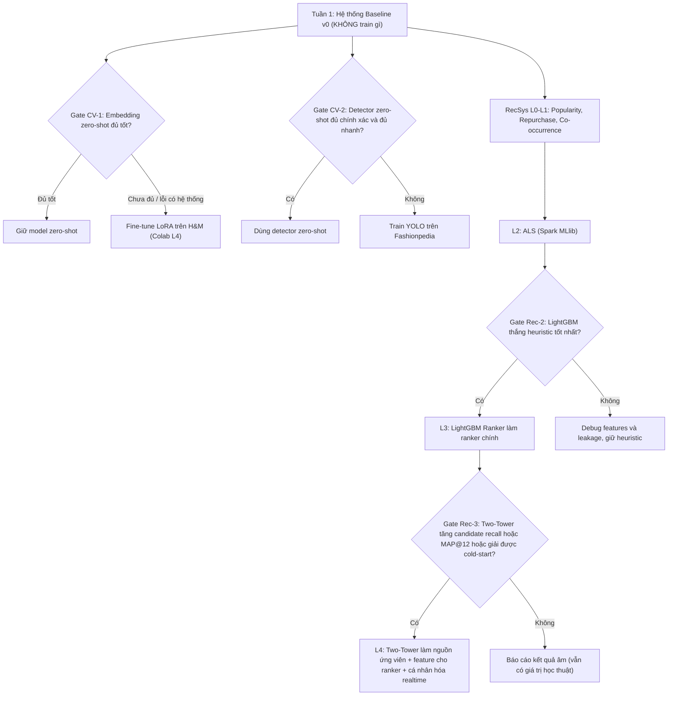
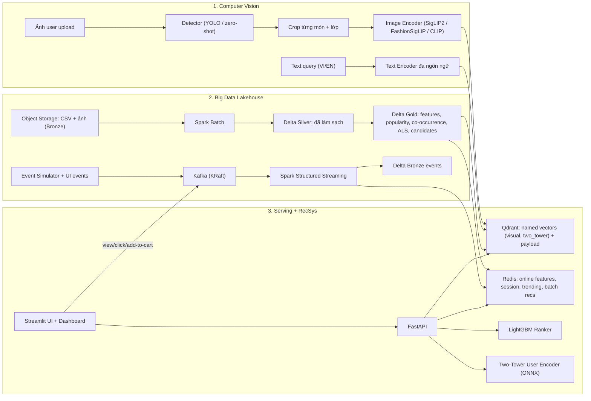
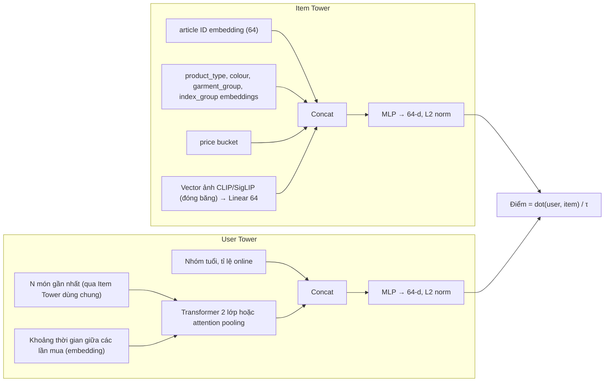
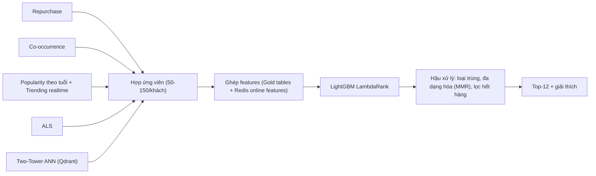

# KẾ HOẠCH v2 — HỆ THỐNG TÌM KIẾM ẢNH & GỢI Ý THỜI TRANG CÁ NHÂN HÓA TRÊN KIẾN TRÚC LAKEHOUSE

> **Phiên bản:** v2 (đã rà soát lại & sửa từ plan của Gemini — file `gemini-code-1792034032575.md`)
> **Nguyên tắc chủ đạo:** *Làm Baseline trước → Đo → Chỉ train/fine-tune khi số liệu chứng minh là cần (Decision Gates).*
> **Phần cứng:** Laptop RTX 4060 8GB VRAM, RAM 24GB · Colab Pro+ (ngân sách ~200 Compute Units/tháng)

---

## MỤC LỤC

0. [TL;DR — Kết luận nhanh](#0-tldr--kết-luận-nhanh)
1. [Đánh giá plan của Gemini](#1-đánh-giá-plan-của-gemini)
2. [Thẩm định Dataset (H&M 256x256 & Fashionpedia có thật sự phù hợp?)](#2-thẩm-định-dataset)
3. [Triết lý: Baseline-first & Decision Gates](#3-triết-lý-baseline-first--decision-gates)
4. [Kiến trúc tổng thể v2](#4-kiến-trúc-tổng-thể-v2)
5. [Module Computer Vision (chi tiết)](#5-module-computer-vision)
6. [Module Recommendation — Có nên dùng Neural Network?](#6-module-recommendation--có-nên-dùng-neural-network)
7. [Module Big Data (Lakehouse + Streaming)](#7-module-big-data)
8. [Hạ tầng, tài nguyên & ngân sách Colab](#8-hạ-tầng-tài-nguyên--ngân-sách-colab)
9. [Timeline chi tiết 6 tuần (+ bản cắt gọn 4 tuần)](#9-timeline-chi-tiết)
10. [Các bảng thực nghiệm sẽ báo cáo](#10-các-bảng-thực-nghiệm-sẽ-báo-cáo)
11. [Rủi ro & phương án dự phòng](#11-rủi-ro--phương-án-dự-phòng)
12. [Cấu trúc repo](#12-cấu-trúc-repo)
13. [Viết vào CV (KHÔNG bịa số)](#13-viết-vào-cv)
14. [Checklist nghiệm thu cuối](#14-checklist-nghiệm-thu-cuối)

---

## 0. TL;DR — Kết luận nhanh

| Câu hỏi | Trả lời ngắn |
| :--- | :--- |
| **H&M có phải dataset chính phù hợp nhất?** | **Có, và gần như không có lựa chọn thay thế tốt hơn.** Đây là dataset public hiếm hoi có đồng thời ảnh + metadata sản phẩm + 31,8 triệu giao dịch + thông tin khách hàng, nối với nhau bằng khóa `article_id`/`customer_id`. |
| **Bản 256x256 có dùng được không?** | **Dùng được làm "bản làm việc"** cho training/indexing (các model đều nhận input 224px). Nhưng: (1) dung lượng thực tế là **~2,29 GB** chứ không phải 1,5 GB như Gemini ghi; (2) **phải kiểm tra ảnh có bị bóp méo tỉ lệ không** (ảnh gốc H&M là ảnh dọc, không vuông). Chi tiết ở [mục 2.2](#22-bản-hm-256x256--dùng-được-nhưng-phải-kiểm-tra-2-điều). |
| **Fashionpedia có phù hợp?** | **Phù hợp nhất để train Detector** (tốt hơn ModaNet và DeepFashion2 cho bài toán này). Nhưng **nó KHÔNG phải dataset "chính"** — chỉ là dataset phụ cho đúng 1 module (phát hiện & cắt trang phục). Dataset chính vẫn là H&M. |
| **Còn thiếu gì?** | Thiếu **dữ liệu đánh giá street → shop** (ảnh đời thực → sản phẩm catalog). Plan v2 bổ sung: tập ảnh tự thu thập tại VN có gán nhãn độ liên quan + một chỉ số tự động trên tập val của Fashionpedia. |
| **Train/fine-tune ngay?** | **Không.** Tuần 1 dựng xong hệ thống chạy được end-to-end **mà không train gì cả** (model pre-trained + thuật toán đếm). Sau đó mới mở từng "cổng" (gate) train/fine-tune nếu số liệu cho thấy cần. |
| **RecSys có nên dùng Neural Network?** | **Có — nhưng không phải ngay từ đầu và không thay thế toàn bộ.** Lộ trình: Heuristic → ALS → **LightGBM Learning-to-Rank** → **Two-Tower Neural Network** (dùng vector ảnh CLIP làm feature của item). Bản cuối là hệ **Hybrid**: Neural Network lo phần *Retrieval* (sinh ứng viên + cá nhân hóa realtime + cold-start), GBDT lo phần *Ranking*. Đây cũng là kiến trúc mà các đội top của cuộc thi H&M trên Kaggle dùng. Chi tiết ở [mục 6](#6-module-recommendation--có-nên-dùng-neural-network). |
| **Điểm yếu lớn nhất của plan Gemini?** | (1) Công thức rerank cộng trọng số `w1..w4` **chọn tay**, không học được → đúng là "không ổn" như bạn cảm thấy; (2) **bịa số kết quả** trước khi làm (Recall +14,2%, 8,5x, <120ms...); (3) không có giao thức đánh giá cho bài toán street→shop; (4) Docker image Bitnami Kafka và MinIO đã thay đổi chính sách từ 2025. |

---

## 1. Đánh giá plan của Gemini

### 1.1. Những điểm Gemini làm TỐT (giữ lại)

- Chọn H&M làm trục xuyên suốt CV + Big Data + RecSys → đúng.
- Chia train/test theo `product_code` để tránh leakage giữa các màu của cùng một mẫu → đúng.
- Kiến trúc Two-Stage (Retrieval → Ranking) → đúng hướng.
- Dùng Qdrant với payload filter, chuẩn hóa L2, scalar quantization → hợp lý.
- Dùng MAP@12 (metric chính thức của cuộc thi H&M) và chia theo thời gian (time-based split) → đúng.
- Có ý tưởng tập ảnh tự chụp tại VN để đánh giá ngoài phân phối (OOD) → rất tốt, giữ lại và **nâng cấp thành giao thức đánh giá có gán nhãn**.

### 1.2. Những vấn đề NGHIÊM TRỌNG (phải sửa)

| # | Vấn đề | Tại sao nguy hiểm | Cách sửa trong v2 |
| :-- | :--- | :--- | :--- |
| 1 | **Bịa số kết quả** trước khi làm: "Recall tăng 8–15%", "14.2%", "8.5x", "<25ms", "<120ms" (cả trong plan lẫn bullet CV). | Hội đồng hỏi "đo thế nào?" là lộ ngay. Đưa vào CV mà phỏng vấn không giải thích được thì mất điểm nặng. | Mọi con số để `[TBD]` cho đến khi đo thật. Mục 13 có template CV dạng placeholder. |
| 2 | **Không có baseline-first**: lao vào train YOLO + fine-tune OpenCLIP + cả ConvNeXt multi-task ngay từ tuần 1–2. | Không chứng minh được việc train là *cần thiết*; tốn CU; nếu fine-tune không cải thiện thì không có gì để so. | Tuần 1 dựng hệ thống chỉ dùng model pre-trained. Mỗi bước train có **Decision Gate** với tiêu chí rõ ràng (mục 3). |
| 3 | **Công thức rerank `Score = w1·S_visual + w2·S_trending + w3·S_session + w4·S_age` chọn trọng số bằng tay.** | Không có cơ sở chọn `w`, không tối ưu được theo metric, không mở rộng được khi thêm feature. Đây chính là chỗ bạn thấy "chỉ thuật toán ranking có vẻ không ổn". | Thay bằng **Learning-to-Rank (LightGBM LambdaRank)** học trọng số từ dữ liệu + **Two-Tower NN** sinh điểm cá nhân hóa (mục 6). |
| 4 | **Không có ground truth cho visual search street→shop.** Plan nói "Recall@K trước/sau fine-tune" nhưng không nói query là gì, đáp án đúng là gì. H&M **không có** cặp ảnh đời thực ↔ sản phẩm. | Không đo được thì không có bảng kết quả môn CV. | Định nghĩa 4 giao thức đánh giá cụ thể (mục 5.1.3): T2I trên H&M, I2I theo thuộc tính, CatConsistency trên Fashionpedia-val, nDCG@10 do người gán nhãn trên tập VN. |
| 5 | **"Hard Positives" theo `product_code`**: các `article_id` cùng `product_code` là **cùng kiểu dáng nhưng khác màu**. Ép chúng gần nhau trong không gian embedding sẽ **dạy model bỏ qua màu sắc** — mâu thuẫn với việc user tìm "áo màu đen". | Giảm chất lượng tìm theo màu. | Dùng `product_code` như một metric phụ ("độ khớp kiểu dáng"), **không** dùng làm positive trong loss chính. Xử lý false-negative trong batch thay vì ép positive. |
| 6 | **Event giả "view_or_purchase"**: H&M **chỉ có giao dịch mua**, không có click/view; `t_dat` chỉ có **ngày**, không có giờ. | Báo cáo Big Data nói "click stream" là sai sự thật về dữ liệu. | Trung thực: replay giao dịch theo thời gian (giờ trong ngày được sinh ngẫu nhiên — ghi rõ trong báo cáo) + event thật do người dùng thao tác trên UI demo (view/click/add-to-cart). |
| 7 | **Text query tiếng Việt** ("đổi sang màu nâu") đưa thẳng vào OpenCLIP (chỉ hiểu tiếng Anh). | Kết quả gần như ngẫu nhiên khi demo trước hội đồng. | Benchmark model **đa ngôn ngữ** (SigLIP 2) hoặc dịch VI→EN trước khi encode. Gọi đúng tên bài toán "đổi màu" là *Composed Image Retrieval* và đánh giá định tính. |
| 8 | **Docker image lỗi thời**: `bitnami/kafka` đã bị Broadcom chuyển sang repo `bitnamilegacy` (không còn cập nhật) từ 28/08/2025; MinIO bản community đã ngừng phát hành binary/Docker image chính thức và chuyển sang chế độ bảo trì. | `docker compose up` có thể pull lỗi hoặc dùng image không vá bảo mật. | Dùng image chính thức `apache/kafka` (KRaft); MinIO pin một tag cụ thể (chỉ chạy local) hoặc thay bằng SeaweedFS/Garage (mục 8.3). |

### 1.3. Những vấn đề NHỎ

- Ghi "gom về **7 lớp**" nhưng liệt kê **8 lớp** (top, outer, pants, shorts, skirt, dress, footwear, bag).
- Ghi "Kappa/Lambda" lẫn lộn — hệ thống có cả Batch layer + Speed layer + Serving layer thì là **Lambda**.
- `partitionBy("Year","Month")` cho 31,8 triệu dòng thì ổn, nhưng nên cân nhắc partition theo `week` vì toàn bộ bài toán RecSys xoay quanh tuần; và tránh sinh quá nhiều file nhỏ.
- OpenCLIP `ViT-B/32` đã cũ — năm 2026 có nhiều lựa chọn tốt hơn (SigLIP 2, FashionSigLIP, DINOv2/v3) để *benchmark trước*.
- Lọc Qdrant theo `product_group_name` là quá thô (ví dụ "Garment Upper body" chứa cả áo phông lẫn áo khoác). Nên map lớp detector → **tập `product_type_name`**.
- Chạy Spark trực tiếp trên Windows rất khổ (winutils, đường dẫn). Nên chạy trong **WSL2**.
- `version: '3.8'` trong docker-compose đã lỗi thời (Compose v2 bỏ qua trường này).
- 4 tuần cho 1 người làm: YOLO + CLIP fine-tune + Spark batch + Kafka + Streaming + RecSys + FastAPI + UI + 2 báo cáo là **quá tải**. Plan v2 đưa ra 6 tuần và một bản cắt gọn 4 tuần với danh sách "bắt buộc / tùy chọn".

---

## 2. Thẩm định Dataset

### 2.1. H&M Personalized Fashion Recommendations — Dataset CỐT LÕI ✅

**Thông số đã kiểm tra:**

| Bảng | Quy mô | Vai trò |
| :--- | :--- | :--- |
| `articles.csv` | 105.542 sản phẩm × 25 cột | Metadata: loại sản phẩm (131 loại), màu (50), họa tiết (30), mô tả text... |
| `customers.csv` | 1.371.980 khách hàng | Tuổi, trạng thái thành viên, tần suất nhận tin... |
| `transactions_train.csv` | 31.788.324 giao dịch (2018-09-20 → 2020-09-22) | Xương sống của Big Data + RecSys |
| `images/` | ~105.100 ảnh (một số article không có ảnh) | CV: trích xuất embedding, index vào Qdrant |

**So sánh với các lựa chọn thay thế — vì sao H&M thắng:**

| Dataset | Có ảnh? | Có giao dịch thật? | Có thông tin khách? | Nhận xét |
| :--- | :---: | :---: | :---: | :--- |
| **H&M (Kaggle)** | ✅ ~105K | ✅ 31,8M | ✅ 1,37M | **Duy nhất có đủ cả 3, cùng khóa nối.** |
| Amazon Reviews (Fashion) | Chỉ URL (nhiều link chết) | Rating/review, không phải mua thật | ❌ | Tín hiệu là đánh giá, không phải hành vi mua. |
| Polyvore Outfits | ✅ | ❌ (chỉ outfit) | ❌ | Tốt cho phối đồ, không có lịch sử mua. |
| Alibaba iFashion / POG | URL ảnh | Click log | Hạn chế | Thị trường TQ, khó tải ảnh, tài liệu ít. |
| DeepFashion / DeepFashion2 | ✅ | ❌ | ❌ | Chỉ là dataset CV. |

> [!IMPORTANT]
> **Lưu ý giấy phép:** Dữ liệu H&M thuộc điều khoản cuộc thi Kaggle — dùng cho mục đích học thuật/phi thương mại. Ghi rõ nguồn trong báo cáo và README; **không** public lại ảnh gốc lên GitHub (chỉ public code + hướng dẫn tải).

**Các "bẫy" kỹ thuật khi xử lý H&M (Gemini không nhắc):**

1. `article_id` đọc bằng Spark/Pandas mặc định sẽ thành số nguyên → **mất số 0 ở đầu** (`0108775015` → `108775015`) → không tìm được file ảnh. **Phải ép kiểu string và pad 10 ký tự** ngay ở tầng Bronze.
2. `customer_id` là chuỗi hex 64 ký tự × 31,8 triệu dòng ≈ vài GB RAM chỉ cho cột này. **Map sang `int32` index** ở tầng Silver (giữ bảng mapping) → giảm RAM rất nhiều cho ALS, LightGBM, Two-Tower.
3. `price` đã bị chuẩn hóa (không phải giá thật) → chỉ dùng tương đối.
4. Tuần cuối (2020-09-16 → 2020-09-22) dùng làm **validation**; phần lớn khách hàng **không mua gì** trong tuần đó → MAP@12 chỉ tính trên khách có mua.
5. Có giao dịch trùng lặp (cùng khách, cùng ngày, cùng sản phẩm nhiều dòng) — giữ lại như "số lượng", không xóa bừa.

### 2.2. Bản H&M 256x256 — Dùng được, nhưng phải kiểm tra 2 điều

**Thông tin đã kiểm tra trên Kaggle:** dataset `odins0n/hm256x256` ("H&M-(256x256) dataset", tác giả Sanskar Hasija), tạo bằng notebook `h-m-image-resizer-dataset-256x256`, file zip **~2,29 GB** (Gemini ghi 1,5 GB là sai).

| Ưu điểm | Nhược điểm / rủi ro |
| :--- | :--- |
| Nhẹ hơn ~15 lần so với bản gốc (~29 GB zip / ~34 GB giải nén) → tải nhanh, I/O nhanh khi train trên Colab. | **Ảnh gốc H&M là ảnh dọc (tỉ lệ ~2:3).** Nếu notebook resize thẳng về 256×256 thì **ảnh bị bóp méo** (quần trông ngắn và béo ra). |
| Mọi model dự kiến dùng (CLIP/SigLIP/DINOv2) đều nhận input 224px → 256px là đủ thông tin. | Hiển thị trên UI hơi mờ (chấp nhận được cho demo). |
| Giữ nguyên cấu trúc thư mục theo `article_id` → không phải đổi code. | Là dataset do cộng đồng tạo, không phải bản chính thức. |

**Cách kiểm tra (làm ngày 1, mất 10 phút):**

```python
from PIL import Image
import glob, random
paths = random.sample(glob.glob("hm256/images/*/*.jpg"), 20)
for p in paths:
    im = Image.open(p); print(p, im.size)
# Mở ~20 ảnh ra xem: nếu quần/váy dài trông "lùn và béo" → ảnh đã bị bóp méo.
# Nếu có viền trắng 2 bên → ảnh đã được padding (giữ tỉ lệ) → tốt.
```

**Quyết định:**

- **Nếu ảnh được padding giữ tỉ lệ** → dùng luôn bản 256 cho mọi thứ.
- **Nếu ảnh bị bóp méo** → có 2 lựa chọn:
  - **(Khuyến nghị)** Tự resize từ bản gốc: mở Colab **CPU runtime** (tốn rất ít CU), tải bản gốc từ Kaggle, chạy script resize *giữ tỉ lệ + pad nền trắng* về 256 (cho model) và 384 (cho UI), nén lại và lưu Google Drive. Chỉ làm 1 lần.
  - Hoặc dùng bản 256 nhưng **áp dụng đúng phép bóp méo đó cho ảnh query** (crop từ detector cũng resize thẳng về vuông) để train/test nhất quán. Cách này chạy được nhưng kém hơn.

### 2.3. Dataset cho Detector — Fashionpedia là lựa chọn tốt nhất ✅ (nhưng chỉ là dataset PHỤ)

**Thông số Fashionpedia (đã kiểm tra bản Hugging Face `detection-datasets/fashionpedia`):**
- ~48,8K ảnh (bản HF có split `train` ~45,6K và `val` ~1,2K; nhãn tập test gốc không công khai).
- **46 lớp** = 27 lớp trang phục chính + 19 lớp "bộ phận" (tay áo, cổ áo, túi, khóa kéo...).
- Nhãn bbox (bản HF); bản gốc trên GitHub có thêm segmentation mask + 294 thuộc tính.
- Giấy phép **CC BY 4.0** (thoải mái nhất trong các lựa chọn).
- Ảnh đời thường + sự kiện người nổi tiếng → gần với ảnh "street" mà user sẽ upload.

**So sánh 3 ứng viên:**

| Tiêu chí | **Fashionpedia** | ModaNet | DeepFashion2 |
| :--- | :--- | :--- | :--- |
| Số ảnh | ~48,8K | ~55K | ~491K |
| Có **giày** | ✅ `shoe` | ✅ `footwear`, `boots` | ❌ **Không có** |
| Có **túi, mũ, kính, thắt lưng, khăn** | ✅ đủ | ✅ phần lớn | ❌ **Không có** |
| Chất lượng nhãn | Cao (chuyên gia thời trang xây ontology) | Có nhiễu (đã được cộng đồng báo cáo) | Cao |
| Độ khó lấy dữ liệu | **Dễ nhất** (HF parquet, 1 lệnh) | **Khó**: annotation riêng, ảnh phải lấy từ dataset PaperDoll | Phải điền form xin mật khẩu giải nén |
| Giấy phép | CC BY 4.0 | Annotation mở, ảnh theo PaperDoll | Chỉ nghiên cứu phi thương mại |
| Phân lớp có khớp H&M? | Khá khớp (shirt, sweater, cardigan, jacket, coat, pants, shorts, skirt, dress...) | Thô (chỉ `top`, `outer`) | Chia theo **độ dài tay áo** (short/long sleeve top...) — H&M không phân loại kiểu này |
| Có cặp street↔shop? | ❌ | ❌ | ✅ (cặp consumer–commercial) |

**Kết luận:** Fashionpedia thắng cho module Detector vì H&M bán **rất nhiều giày, túi, phụ kiện** — DeepFashion2 không detect được những thứ này; ModaNet thì khó lấy ảnh và nhãn nhiễu hơn. DeepFashion2 chỉ đáng cân nhắc ở **giai đoạn nâng cao** nếu muốn fine-tune riêng bài toán street→shop bằng cặp ảnh của nó.

> [!WARNING]
> **Fashionpedia KHÔNG phải dataset "chính".** Nó chỉ phục vụ một việc: dạy detector tìm & cắt từng món đồ trong ảnh đời thực. Toàn bộ phần retrieval, Big Data, RecSys chạy trên H&M. Trong báo cáo hãy trình bày đúng vai trò này.

**Bảng gộp lớp Fashionpedia → lớp detector → tập `product_type_name` của H&M (để lọc Qdrant):**

| Lớp detector (v2) | Gộp từ lớp Fashionpedia | Lọc Qdrant theo H&M `product_type_name` (ví dụ, hoàn thiện khi EDA) |
| :--- | :--- | :--- |
| `top` | shirt/blouse, top/t-shirt/sweatshirt, sweater, cardigan, vest | T-shirt, Top, Vest top, Shirt, Blouse, Sweater, Cardigan, Hoodie, Polo shirt... |
| `outerwear` | jacket, coat, cape | Jacket, Coat, Blazer, Outdoor Waistcoat... |
| `pants` | pants | Trousers, Leggings/Tights (một phần), Jeans... |
| `shorts` | shorts | Shorts |
| `skirt` | skirt | Skirt |
| `dress` | dress, jumpsuit | Dress, Jumpsuit/Playsuit, Dungarees |
| `shoe` | shoe | Sneakers, Boots, Sandals, Ballerinas, Pumps, Other shoe... |
| `bag` | bag/wallet | Bag, Backpack, Cross-body bag, Wallet... |
| `hat` | hat, headband/head covering/hair accessory | Hat/beanie, Cap/peaked, Hat/brim, Hair/alice band... |
| `eyewear` | glasses | Sunglasses |
| `scarf_tie` | scarf, tie | Scarf, Tie |
| `belt` | belt | Belt |
| *(bỏ)* | watch, umbrella, glove, leg warmer, tights, sock + **toàn bộ 19 lớp bộ phận** | — (quá hiếm hoặc không phải món đồ độc lập) |

> Bảng map này nên lưu thành file `configs/class_mapping.yaml`, có thể mở rộng trong lúc làm EDA.

### 2.4. Dataset ĐÁNH GIÁ street → shop (phần Gemini thiếu)

Không có ground truth thì không có bảng kết quả môn CV. Plan v2 dùng **3 tầng đánh giá**:

| Tầng | Dữ liệu | Cách đo | Tự động? |
| :--- | :--- | :--- | :---: |
| **A. In-domain** | Tập test H&M (chia theo `product_code`) | T2I Recall@K; I2I Precision@K theo loại/màu | ✅ |
| **B. Proxy street→shop** | ~1.000–2.000 crop từ **Fashionpedia val** (đã có nhãn lớp) | **CatConsistency@10**: trong top-10 sản phẩm H&M trả về, bao nhiêu % có `product_type` thuộc đúng lớp của crop | ✅ |
| **C. Thực tế VN** | **150–200 ảnh tự thu thập** (bạn bè, ảnh feedback công khai...) | Người chấm điểm liên quan 0–3 cho top-10 → **nDCG@10**, P@10; 2 người chấm, tính **Cohen's kappa** | Bán tự động (tool chấm điểm bằng Streamlit) |

**Thang điểm gán nhãn cho tầng C:**
- `0` — sai loại đồ (tìm quần ra áo)
- `1` — đúng loại đồ, sai màu/kiểu
- `2` — đúng loại + đúng màu (hoặc rất gần)
- `3` — gần như giống hệt (kiểu dáng + màu + họa tiết)

**(Tùy chọn nâng cao)** DeepFashion2 consumer-to-shop pairs: dùng nếu muốn đo/fine-tune bài toán cross-domain một cách bài bản hơn.

### 2.5. Chốt bộ dataset

| Vai trò | Dataset | Bắt buộc? |
| :--- | :--- | :---: |
| Lõi (CV retrieval + Big Data + RecSys) | **H&M** (CSV đầy đủ + ảnh 256 đã kiểm tra tỉ lệ) | ✅ |
| Train Detector | **Fashionpedia** (HF `detection-datasets/fashionpedia`) | ✅ |
| Đánh giá thực tế | **Tập VN tự thu thập** 150–200 ảnh, có gán nhãn | ✅ |
| Đánh giá proxy tự động | Crop từ Fashionpedia val | ✅ (miễn phí, có sẵn) |
| Nâng cao street→shop | DeepFashion2 (cặp consumer–shop) | ⬜ Tùy chọn |

---

## 3. Triết lý: Baseline-first & Decision Gates

Bạn nghĩ đúng: **làm baseline trước rồi mới nâng cấp là cách hợp lý nhất**, vì:

1. **Có mốc so sánh** → mọi cải tiến đều đo được ("tăng bao nhiêu so với baseline").
2. **Có hệ thống chạy được sớm** → giảm rủi ro "đến tuần 4 vẫn chưa ghép được gì".
3. **Không lãng phí CU** → chỉ train khi baseline chưa đủ tốt.
4. **Baseline không phải đồ bỏ đi** → trong RecSys, các baseline heuristic sau này trở thành *nguồn sinh ứng viên* cho ranker.

### 3.1. Bảng quyết định: thành phần nào train, thành phần nào không

| Thành phần | Baseline (không train) | Có train/fine-tune không? | Điều kiện |
| :--- | :--- | :--- | :--- |
| Embedding ảnh/text | Model pre-trained zero-shot tốt nhất trong 4–5 ứng viên | **Fine-tune nếu qua Gate CV-1** | Xem 5.1.4 |
| Detector | Không detect (dùng cả ảnh) + detector zero-shot (YOLO-World/Grounding DINO) | **Train YOLO nếu qua Gate CV-2** (gần như chắc chắn qua) | Xem 5.2.3 |
| Popularity / Co-occurrence / Repurchase | Đếm bằng Spark | **Không train** (thuật toán đếm) | — |
| ALS | — | Train (rẻ, chạy CPU bằng Spark MLlib) | Giữ nếu tăng candidate recall |
| Ranker | Công thức tay (chỉ làm mốc so sánh) | **Train LightGBM** (bản chất là học, CPU, vài phút) | Phải thắng heuristic tốt nhất |
| Two-Tower NN | — | **Train** sau khi có ranker | Gate Rec-3 |
| Dịch tiếng Việt | Model đa ngôn ngữ có sẵn | **Không train** | — |

### 3.2. Sơ đồ các Gate



> [!TIP]
> **Kết quả âm cũng là kết quả.** Nếu fine-tune không giúp, viết vào báo cáo: "Fine-tune làm tăng in-domain nhưng giảm trên tập VN do overfit vào ảnh studio → chọn giữ zero-shot / dùng WiSE-FT". Hội đồng đánh giá cao tư duy thực nghiệm này hơn là những con số đẹp không giải thích được.

---

## 4. Kiến trúc tổng thể v2



**Ba luồng nghiệp vụ chính:**

| API | Mô tả | Luồng xử lý |
| :--- | :--- | :--- |
| `POST /visual-search` | Tìm sản phẩm giống ảnh (+text) và cá nhân hóa | Detector → crop → encoder → Qdrant (lọc theo `product_type`) top-100 → rerank cá nhân hóa (visual sim + điểm Two-Tower/ranker) → top-12 + giải thích |
| `GET /recommend/{customer_id}` | Gợi ý cá nhân hóa trang chủ | Ứng viên batch (Redis) ∪ ứng viên realtime (Two-Tower từ session Redis → Qdrant) ∪ trending → LightGBM rerank → top-12 |
| `GET /outfit/{article_id}` | Gợi ý phối đồ (Complete the Look) | Co-occurrence **khác nhóm** (quần → áo, giày) + fallback co-occurrence theo `product_type` cho item mới |
| `POST /events` | Ghi nhận hành vi từ UI | → Kafka → Streaming → Redis (session + trending) |

---

## 5. Module Computer Vision

### 5.1. Embedding (trái tim của Visual Search)

#### 5.1.1. Bước 1 — Benchmark zero-shot (KHÔNG train) trên laptop

Chạy trên RTX 4060 (FP16), mỗi model trích ~105K vector mất cỡ vài phút đến vài chục phút → **0 CU**.

| Ứng viên | Checkpoint (gợi ý) | Dim | Lý do đưa vào |
| :--- | :--- | :---: | :--- |
| CLIP ViT-B/32 | `openai/clip-vit-base-patch32` | 512 | Mốc "cổ điển" (cái Gemini đề xuất) |
| SigLIP 2 Base | `google/siglip2-base-patch16-224` | 768 | Mạnh hơn CLIP, **text đa ngôn ngữ** → hợp query tiếng Việt |
| FashionCLIP | `patrickjohncyh/fashion-clip` | 512 | CLIP fine-tune trên dữ liệu thời trang |
| Marqo-FashionSigLIP | `Marqo/marqo-fashionSigLIP` (open_clip) | 768 | Model thời trang mạnh, có sẵn — *ghi chú: chưa rõ dữ liệu train, cần nêu trong báo cáo* |
| DINOv2 Base | `facebook/dinov2-base` | 768 | Chỉ ảnh (không text) — mốc cho bài toán ảnh→ảnh thuần thị giác |

> Kiểm tra lại tên checkpoint trên Hugging Face lúc làm (các model mới ra liên tục; có thể thay bằng phiên bản mới hơn như DINOv3 nếu giấy phép cho phép).

#### 5.1.2. Chia dữ liệu

- Chia theo **`product_code`** (giữ của Gemini): ~85% train / ~7,5% val / ~7,5% test. Các `article_id` cùng `product_code` luôn nằm chung một tập.
- Lưu split cố định vào `data/splits/hm_split_v1.parquet` (seed cố định) → mọi thí nghiệm dùng chung.

#### 5.1.3. Giao thức đánh giá (định nghĩa chính xác)

| Metric | Query | "Đúng" là gì | Ghi chú |
| :--- | :--- | :--- | :--- |
| **T2I R@1/5/10** | Caption của article test (sinh từ template, xem 5.1.5) | Ảnh của chính article đó (hoặc article có caption trùng y hệt) | Đo khả năng hiểu text→ảnh trong domain |
| **I2I P@10-type** | Ảnh article test, tìm trong toàn catalog (trừ chính nó) | Item cùng `product_type_name` | Đo đúng loại |
| **I2I P@10-type+colour** | như trên | Cùng `product_type_name` **và** `colour_group_name` | Đo đúng loại + màu |
| **I2I R@10-style** | như trên | Item cùng `product_code` (cùng kiểu, khác màu) | Đo khớp kiểu dáng (metric phụ) |
| **CatConsistency@10** | Crop từ Fashionpedia val (cắt theo bbox nhãn thật) | `product_type` thuộc tập map của lớp crop | Proxy street→shop tự động |
| **nDCG@10 (VN)** | Crop từ ảnh VN | Điểm người chấm 0–3 | Thước đo cuối cùng |
| **Latency** | — | ms/ảnh trên 4060 (PyTorch vs ONNX FP16) | Cho phần hệ thống |

#### 5.1.4. Gate CV-1 — Khi nào fine-tune?

Fine-tune **chỉ khi** thỏa ít nhất một điều kiện:
1. Phân tích lỗi (xem 50 query tệ nhất) cho thấy **lỗi có hệ thống do domain H&M** (vd: nhầm `Vest top` ↔ `Top`, nhầm `Dark Blue` ↔ `Black`, không hiểu thuật ngữ H&M trong caption).
2. T2I R@10 của model tốt nhất còn thấp rõ rệt so với kỳ vọng nhóm đặt ra sau khi xem kết quả (vd: chênh lớn giữa model tổng quát và model thời trang → chứng tỏ còn dư địa domain-adaptation).

Và **chỉ giữ model fine-tune** nếu:
- Tăng ≥ ~2–3 điểm trên metric in-domain chính, **và**
- Không giảm quá ~1 điểm trên CatConsistency@10 / nDCG@10 (VN) — tránh overfit vào ảnh studio.

> Ngưỡng là đề xuất; quan trọng là **chốt ngưỡng TRƯỚC khi chạy** và ghi vào báo cáo.

#### 5.1.5. Công thức fine-tune (nếu qua gate)

- **Model:** model zero-shot tốt nhất có cả text tower (thường SigLIP 2 hoặc FashionSigLIP).
- **Caption template** (tiếng Anh, ngắn — text encoder SigLIP thường giới hạn ~64 token):
  `"{colour_group_name} {graphical_appearance_name} {product_type_name}, {index_group_name}. {detail_desc (cắt ngắn)}"`
- **Phương pháp:** LoRA (rank 8–16) trên attention của cả 2 tower, **hoặc** mở khóa 2–4 block cuối; LR ~1e-5 (backbone) / 1e-4 (LoRA); 5–10 epoch; AMP bf16; gradient checkpointing.
- **Loss:** dùng đúng loss gốc của model (Sigmoid loss cho SigLIP, InfoNCE đối xứng cho CLIP).
- **Xử lý false negatives trong batch:** nhiều article có caption gần như trùng → khi lấy batch, **mỗi `product_code` tối đa 1 article/batch**, hoặc coi các cặp có caption trùng là positive.
- **Augmentation mô phỏng ảnh đời thực** (rẻ mà hiệu quả cho street→shop): random resized crop, perspective nhẹ, blur, đổi độ sáng/tương phản, **dán sản phẩm lên nền ngẫu nhiên**. **KHÔNG** đổi hue (làm sai màu → sai nhãn màu).
- **WiSE-FT:** nội suy trọng số `θ = α·θ_finetune + (1−α)·θ_zeroshot`, quét α ∈ {0.3, 0.5, 0.7, 1.0} → chọn α cân bằng in-domain và tập VN. Đây là kỹ thuật rẻ, có cơ sở lý thuyết, rất "ăn điểm" khi bảo vệ.
- **Phần cứng:** Colab **L4** (24GB VRAM), batch 256–512 → ước tính 1–3 giờ, **< 10 CU**.
- **Không làm** Multi-task ConvNeXt (Hướng B của Gemini) trừ khi dư thời gian — nó trùng lặp mục tiêu, tốn công, khó tạo khác biệt.

### 5.2. Detector (phát hiện & cắt từng món đồ)

#### 5.2.1. Tại sao cần detector?

- Ảnh street chứa nhiều món đồ + người + nền → một vector cho cả ảnh bị "loãng".
- Cho phép UI vẽ bbox, user chọn món muốn tìm → trải nghiệm tốt.
- Cho phép **lọc Qdrant theo loại** (crop giày → chỉ tìm trong giày).

#### 5.2.2. Baseline (không train)

1. **B0 — Không detect:** đưa cả ảnh vào encoder.
2. **B1 — Detector zero-shot:** YOLO-World (nhanh) và/hoặc Grounding DINO (chính xác hơn, chậm) với prompt là tên 12 lớp.
3. Đo trên **Fashionpedia val** (đã map lớp): mAP@50, mAP@50-95, latency trên 4060.

#### 5.2.3. Gate CV-2 — Train YOLO khi nào?

Train nếu detector zero-shot có **mAP@50 thấp** (thường gặp với lớp thời trang chi tiết) **hoặc latency > ~100 ms/ảnh** trên 4060. Thực tế gần như chắc chắn sẽ phải train, nhưng có baseline thì bảng so sánh mới có nghĩa: *"Fine-tune YOLO tăng mAP@50 từ X lên Y và nhanh hơn Z lần so với Grounding DINO zero-shot."*

#### 5.2.4. Công thức train YOLO

| Hạng mục | Thiết lập |
| :--- | :--- |
| Model | YOLO11 (s và m) của Ultralytics — hoặc phiên bản mới nhất của Ultralytics tại thời điểm làm (kiểm tra docs) |
| Dữ liệu | Fashionpedia → định dạng YOLO; **12 lớp** theo bảng mục 2.3; bỏ các object thuộc lớp bị loại |
| Tiền xử lý | Resize ảnh gốc về cạnh dài ≤ 1024 px **trước khi train** (ảnh gốc khá lớn → giảm I/O rất nhiều) |
| Split | train (Fashionpedia train trừ ~5% làm val riêng) / val (5% đó) / **test = Fashionpedia val chính thức** |
| Thử nhanh (local 4060) | YOLO11n/s, imgsz 640, 10–20 epoch, batch 16, AMP → smoke test pipeline, **0 CU** |
| Train chính (Colab L4) | YOLO11m, imgsz 640, ~50–80 epoch, early stopping (`patience=15`), `save_period=1` lưu vào Drive, `resume=True` khi mất kết nối |
| Mất cân bằng lớp | Theo dõi AP từng lớp; nếu lớp hiếm (eyewear, belt) quá thấp → oversample ảnh chứa lớp đó |
| Export | ONNX FP16 (và thử TensorRT trên 4060); đo latency thật thay vì hứa "gấp 2–3 lần" |
| Đầu ra báo cáo | PR curve, confusion matrix, AP từng lớp, bảng so sánh với baseline zero-shot |

> [!IMPORTANT]
> **Mẹo Colab:** luôn copy dataset (đã zip) từ Drive vào ổ `/content` rồi giải nén trước khi train. Đọc ảnh trực tiếp từ Drive mount chậm hơn rất nhiều và đốt CU vô ích.

#### 5.2.5. Xử lý phía catalog (điểm Gemini bỏ sót)

Một phần ảnh H&M có **người mẫu mặc cả bộ** (vd: sản phẩm là quần nhưng ảnh có cả áo). Khi đó vector của "quần" bị nhiễm thông tin của "áo".
- **EDA:** chạy detector trên toàn bộ catalog, thống kê % ảnh có > 1 món đồ.
- **Nếu tỉ lệ đáng kể:** crop catalog theo đúng lớp của sản phẩm (sản phẩm là Trousers → lấy bbox `pants`) rồi mới trích vector.
- **Ablation:** `catalog full-image` vs `catalog cropped` trên CatConsistency@10 và nDCG@10 (VN). Đây là một thí nghiệm có giá trị học thuật thật.

### 5.3. Text query & tiếng Việt

- **Phương án 1 (ưu tiên):** dùng text encoder đa ngôn ngữ (SigLIP 2) → benchmark trực tiếp 30–50 câu query tiếng Việt tự viết.
- **Phương án 2:** dịch VI→EN bằng một model dịch nhỏ chạy local trước khi encode.
- **Ảnh + text ("giống ảnh này nhưng màu nâu"):** đây là *Composed Image Retrieval*. Baseline đơn giản: `v = normalize(α·v_img + (1−α)·v_text)` hoặc lọc payload `colour_group_name` nếu text chứa tên màu. Đánh giá định tính trong demo — **không** hứa con số.

---

## 6. Module Recommendation — Có nên dùng Neural Network?

### 6.1. Phân tích 3 phương án bạn đang phân vân

| Phương án | Ưu | Nhược | Kết luận |
| :--- | :--- | :--- | :--- |
| **(A) Chỉ thuật toán + công thức rerank tay** (plan Gemini) | Nhanh, dễ hiểu | Trọng số `w` chọn mò; không học từ dữ liệu; không tận dụng được vector ảnh một cách có hệ thống; "điểm học thuật" thấp | ❌ Không đủ — đúng như bạn cảm thấy |
| **(B) Deep Learning ngay từ đầu** | Nghe "xịn" | Không có mốc để chứng minh DL tốt hơn; trên H&M, **các mô hình heuristic + GBDT rất mạnh** — DL đứng một mình thường không thắng; debug khó; tốn thời gian sớm khi pipeline đánh giá còn chưa có | ❌ Rủi ro cao |
| **(C) Thang nâng cấp: Heuristic → ALS → LightGBM LTR → Two-Tower NN, cuối cùng là Hybrid** | Mỗi bậc là baseline của bậc sau; mọi cải tiến đều đo được; baseline được tái sử dụng làm nguồn ứng viên; DL được đặt **đúng chỗ nó mạnh nhất** | Nhiều bậc hơn → cần quản lý thời gian | ✅ **Khuyến nghị** |

**Vì sao phương án C hợp lý về mặt kỹ thuật (không chỉ vì "an toàn"):**

1. **Bằng chứng từ chính cuộc thi H&M:** các giải pháp top đều dùng kiến trúc *nhiều nguồn sinh ứng viên (repurchase, co-occurrence, popularity theo tuổi, ALS/embedding...) + GBDT ranker (LightGBM/CatBoost)*. Mạng nơ-ron chủ yếu đóng vai trò **sinh ứng viên hoặc sinh feature** (embedding) cho ranker, chứ không thay thế ranker.
2. **Dữ liệu ranking là dạng bảng** (tuổi, số lần mua, giá, thời gian từ lần mua cuối...) → GBDT là công cụ mạnh nhất cho dữ liệu bảng.
3. **Neural Network mạnh ở những chỗ GBDT yếu:**
   - Học **biểu diễn** (embedding) người dùng từ chuỗi hành vi.
   - **Truy hồi nhanh** trên 105K item bằng ANN (Qdrant).
   - **Cold-start item:** item mới chưa ai mua → GBDT/ALS bó tay, còn Two-Tower dùng **vector ảnh CLIP** làm feature nên vẫn gợi ý được. → **Đây là điểm nối CV × RecSys đẹp nhất của đồ án.**
   - **Cá nhân hóa thời gian thực:** user vừa click 3 món → tính lại user vector trong vài ms từ session trong Redis → kết quả thay đổi ngay. → **Đây là điểm nối Big Data Streaming × RecSys.**

> **Tóm lại:** Đừng hỏi "thuật toán hay deep learning" — hệ thống thực tế ở các công ty lớn đều là **hybrid**. Đồ án của bạn sẽ đi đúng con đường đó và có số liệu chứng minh từng bước.

### 6.2. Giao thức đánh giá RecSys (làm TRƯỚC mọi model)

- **Bài toán:** dự đoán 12 sản phẩm mỗi khách sẽ mua trong 7 ngày tới.
- **Validation:** tuần 2020-09-16 → 2020-09-22. Chỉ dùng dữ liệu trước 2020-09-16 để sinh feature/ứng viên.
- **Huấn luyện ranker:** nhãn lấy từ 1–3 tuần trước đó (vd: tuần 2020-09-09 → 15), feature tính từ dữ liệu trước tuần nhãn tương ứng → **tuyệt đối không leakage**.
- **Metric chính:** **MAP@12** (cài đặt đúng định nghĩa Kaggle, có unit test với ví dụ tay).
- **Metric phụ:** Recall@12; **Candidate Recall@K** (bao nhiêu % món thực sự được mua nằm trong tập ứng viên — quyết định trần của ranker); coverage; phân tích theo nhóm: khách mới / khách ít mua (<3 giao dịch) / item mới.

> [!NOTE]
> **Mức MAP@12 tham khảo** (theo các notebook/thảo luận cộng đồng Kaggle, chỉ để định hướng — **phải tự đo lại** vì tuần validation khác với leaderboard): popularity toàn cục thường dưới ~0,01; heuristic tốt (repurchase + popularity theo thời gian) khoảng ~0,02; pipeline ứng viên + LightGBM tốt khoảng ~0,025–0,03; top leaderboard khoảng ~0,035+. **Đừng thất vọng vì con số nhỏ** — đây là bài toán khó (105K item, dự đoán đúng món cụ thể).

### 6.3. Thang nâng cấp chi tiết

#### L0 — Non-personalized (không train)
- Top-12 bán chạy tuần gần nhất (toàn cục).
- Top-12 theo **nhóm tuổi** (16–22, 23–30, 31–45, 46+), có **trọng số suy giảm theo thời gian** `w = exp(−λ·Δdays)`.
- Vai trò về sau: nguồn ứng viên + phương án cho khách mới (cold-start user).

#### L1 — Heuristic cá nhân hóa (không train)
- **Repurchase:** món khách đã mua gần đây (thời trang có tỉ lệ mua lại/mua thêm size, màu khá cao).
- **Co-occurrence ("hay mua cùng"):** giỏ hàng = (khách, ngày); đếm cặp item cùng giỏ; chuẩn hóa (lift/cosine); lấy top-20 mỗi item. Gợi ý = các món hay đi cùng những món khách vừa mua.
- Kết hợp: repurchase → co-occurrence → popularity theo tuổi (lấp đầy đến 12).
- **Đây thường là baseline rất mạnh trên H&M** — LightGBM phải thắng được nó.

#### L2 — Collaborative Filtering: ALS (train, CPU)
- Spark MLlib ALS implicit, dữ liệu 12–26 tuần gần nhất, confidence = số lần mua × trọng số thời gian.
- Grid nhỏ: `rank ∈ {64, 128}`, `regParam ∈ {0.01, 0.1}`, `alpha ∈ {10, 40}`.
- Đánh giá **cả 2 vai trò**: (a) recommender độc lập (MAP@12), (b) nguồn ứng viên (Candidate Recall@K tăng thêm bao nhiêu khi gộp với L0–L1).
- Đây là phần "Big Data ML" chạy phân tán đúng nghĩa trên Spark.

#### L3 — Learning-to-Rank: LightGBM LambdaRank (train, CPU) ⭐ Thay thế công thức `w1..w4`
**Ứng viên:** hợp của repurchase (≤ 20) + co-occurrence (≤ 30) + popularity theo tuổi (≤ 20) + ALS (≤ 30) → ~50–100 ứng viên/khách, loại trùng. Ghi lại **cờ nguồn** và **thứ hạng trong từng nguồn**.

**Features (~40–60, tính bằng Spark — đây là phần Big Data nặng nhất):**

| Nhóm | Ví dụ |
| :--- | :--- |
| User | tuổi, số giao dịch 1w/4w/toàn bộ, số ngày từ lần mua cuối, giá trung bình/độ lệch chuẩn, tỉ lệ online, tỉ trọng mua theo `product_group`, `club_member_status` |
| Item | doanh số 1w/2w/4w, xu hướng (1w/4w), "tuổi" sản phẩm (ngày từ lần bán đầu), giá trung bình tuần gần nhất, số người mua khác nhau, `product_type`, `garment_group`, `colour`, `index_group` (categorical) |
| User × Item | cờ + rank từng nguồn ứng viên, số lần khách đã mua item này, số ngày từ lần mua item này, số lần khách mua cùng `product_type`/`colour`, điểm ALS, chênh lệch giá so với mức chi tiêu của khách, rank popularity trong nhóm tuổi của khách |
| **CV feature** ⭐ | **cosine(vector ảnh của item, trung bình vector ảnh 5 món khách mua gần nhất)** → đo "gu thị giác" của khách |
| **Two-Tower** (thêm ở L4) | điểm dot-product user·item từ Two-Tower |

**Huấn luyện:** `objective=lambdarank`, group theo khách, nhãn = có mua trong tuần nhãn; lấy mẫu ~10–20% khách cho tập train (đủ lớn, chạy nhanh trên laptop); downsample negative; early stopping trên tuần validation.
**Giải thích:** feature importance + SHAP → vừa có hình cho báo cáo, vừa sinh câu giải thích trên UI.
**Gate Rec-2:** MAP@12 của LightGBM phải **> heuristic tốt nhất** trên tuần validation. Nếu không → gần như chắc chắn có leakage hoặc bug ghép feature → debug trước khi đi tiếp.

#### L4 — Deep Learning: Two-Tower Neural Retrieval (train, RTX 4060) ⭐

**Kiến trúc:**



| Hạng mục | Thiết lập |
| :--- | :--- |
| Dữ liệu | Chuỗi giao dịch 6 tháng gần nhất; mỗi mẫu = (lịch sử ≤ N=30 món trước thời điểm t, món mua tại t). Sinh bằng Spark → Parquet |
| **Không dùng user-ID embedding** | User được biểu diễn hoàn toàn qua lịch sử → **tự động áp dụng cho khách mới** và **cập nhật realtime** khi session thay đổi |
| Loss | Sampled softmax / InfoNCE với in-batch negatives + **hiệu chỉnh logQ** (bù độ phổ biến), nhiệt độ τ ≈ 0,05 |
| Batch / epoch | 2048–4096, 3–10 epoch, AdamW, AMP → vừa VRAM 8GB, **chạy local, 0 CU** |
| Serving | Item vectors → Qdrant (named vector `two_tower`); User tower → ONNX trong FastAPI, input lấy từ `user:{id}:recent` trong Redis |
| Vai trò | (1) nguồn ứng viên mới cho LightGBM, (2) feature `tt_score` cho LightGBM, (3) cá nhân hóa realtime, (4) xử lý **cold-start item** |

**Ablation bắt buộc (bảng "ăn điểm" nhất của đồ án):**

| Biến thể Two-Tower | Candidate Recall@100 | MAP@12 (dùng một mình) | Recall trên **item mới** (lần đầu xuất hiện ở tuần val) |
| :--- | :---: | :---: | :---: |
| ID-only | [TBD] | [TBD] | ≈ 0 (không biết item mới) |
| ID + metadata | [TBD] | [TBD] | [TBD] |
| **ID + metadata + vector ảnh** | [TBD] | [TBD] | [TBD] ← kỳ vọng tốt nhất |

**Gate Rec-3:** giữ Two-Tower trong pipeline cuối nếu nó (a) tăng Candidate Recall khi gộp với các nguồn khác, **hoặc** (b) tăng MAP@12 của LightGBM khi thêm `tt_score`, **hoặc** (c) cải thiện rõ trên nhóm item mới / khách ít lịch sử.

**(Tùy chọn nếu dư thời gian)** SASRec ID-only làm baseline tuần tự; DCN-v2 làm ranker nơ-ron so sánh với LightGBM.

### 6.4. Pipeline RecSys cuối cùng (Hybrid)



**Offline vs Online:**
- **Batch (mỗi "đêm"):** chạy toàn bộ pipeline cho khách active → lưu top-50 vào Redis `user:{id}:recs_batch`.
- **Online (mỗi request):** lấy top-50 batch ∪ ứng viên Two-Tower từ session mới nhất ∪ trending 15 phút → rerank bằng **LightGBM bản "online"** (chỉ dùng feature có sẵn trong Redis) → top-12. Báo cáo cả MAP@12 của bản offline (đầy đủ feature) và bản online.

### 6.5. Cá nhân hóa cho Visual Search (thay công thức `w1..w4`)

- Ứng viên: top-100 từ Qdrant theo vector ảnh (lọc theo `product_type`).
- Điểm cuối: `score = sim_visual + β · z(tt_score(u, i))` — chỉ **1 tham số β** (thay vì 4 trọng số chọn mò), với `z` là chuẩn hóa điểm Two-Tower trong tập ứng viên.
- **Tune β bằng thí nghiệm proxy:** với mỗi cặp (khách u, món i được mua ở tuần val), lấy query = ảnh của **một món khác cùng `product_type` và cùng màu** với i (mô phỏng "thấy món tương tự ngoài đời") → truy hồi visual top-100 → rerank với β → đo HitRate@12 của i. So sánh β = 0 (không cá nhân hóa) với β tối ưu. Nêu rõ giới hạn của proxy trong báo cáo.

---

## 7. Module Big Data

### 7.1. Kiến trúc Lakehouse (Medallion, Lambda)

| Tầng | Định dạng | Nội dung |
| :--- | :--- | :--- |
| **Bronze** | Delta (append-only) | CSV gốc đã ép kiểu tối thiểu (`article_id` string pad 10) + event stream thô từ Kafka |
| **Silver** | Delta, partition theo `week` | Đã làm sạch, `customer_idx` int32, thêm cột `week`, join metadata cần thiết |
| **Gold** | Delta/Parquet | Popularity, co-occurrence, ALS factors, user/item features, candidate tables, ranker training sets, embeddings |
| **Serving** | Redis + Qdrant | Dữ liệu cần tra cứu < 10 ms |

### 7.2. Spark Batch Jobs

| Job | Mô tả | Điểm kỹ thuật để báo cáo |
| :--- | :--- | :--- |
| `B0_ingest` | CSV → Bronze | Schema tường minh (không `inferSchema`), pad `article_id` |
| `B1_silver` | Làm sạch, map `customer_id` → `customer_idx`, thêm `week` | So sánh dung lượng & thời gian truy vấn: CSV vs Parquet vs Delta (tự đo) |
| `B2_eda` | Long-tail, mùa vụ theo tuần, tỉ lệ mua lại, % khách/item mới trong tuần val | Các số liệu này **là lý do thiết kế** (vd: tỉ lệ mua lại cao → cần nguồn repurchase) |
| `B3_popularity` | Toàn cục + theo nhóm tuổi, suy giảm thời gian | Window functions |
| `B4_cooccurrence` | Self-join theo giỏ hàng | **Bài toán Big Data thật:** dữ liệu lệch (skew) do item rất phổ biến → giới hạn kích thước giỏ, salting, chỉ lấy N tuần gần nhất, broadcast join với `articles` |
| `B5_als` | Spark MLlib ALS + grid search nhỏ | Đo thời gian theo số partition/executor memory |
| `B6_candidates` | Hợp các nguồn ứng viên | Candidate Recall@K |
| `B7_features` | User/Item/User×Item features | Hàng chục triệu dòng (khách × ứng viên) → đúng việc của Spark |
| `B8_export` | Đẩy Gold → Redis, Qdrant | Batch upsert, đo thông lượng |

**Thí nghiệm tối ưu Spark (bảng cho môn Big Data):** AQE bật/tắt; broadcast join vs sort-merge join; số shuffle partitions; cache/không cache; Delta `OPTIMIZE ... ZORDER BY`; (tùy chọn) so sánh Spark vs DuckDB trên 1 máy — nhận xét trung thực khi nào Spark có lợi và khi nào không.

### 7.3. Speed Layer: Kafka + Spark Structured Streaming

**Nguồn event (trung thực với dữ liệu):**
1. **Replay** giao dịch tuần validation theo thứ tự thời gian, hệ số tăng tốc cấu hình được (vd: 1 ngày dữ liệu = 2 phút thực). Vì `t_dat` chỉ có ngày → **giờ trong ngày được sinh ngẫu nhiên đều** (ghi rõ trong báo cáo).
2. **Event thật từ UI demo:** `view`, `click`, `add_to_cart`, `purchase` khi người dùng thao tác.

**Schema event (JSON, có thể nâng cấp lên Avro + Schema Registry nếu dư thời gian):**
```json
{
  "event_id": "uuid-v4",
  "event_time": "2020-09-17T14:03:12Z",
  "ingest_time": "2026-11-20T10:15:30Z",
  "customer_id": "000058a12d5b43e6...",
  "article_id": "0706016001",
  "event_type": "purchase | view | click | add_to_cart",
  "source": "replay | ui",
  "price": 0.0338,
  "sales_channel_id": 2
}
```

**Topic:** `fashion-events` (4 partitions, key = `customer_id` → giữ thứ tự theo khách).

**Streaming jobs:**

| Job | Logic | Sink |
| :--- | :--- | :--- |
| `S1_bronze` | Ghi toàn bộ event thô | Delta Bronze (checkpoint, exactly-once với Delta) |
| `S2_trending` | Watermark 10 phút, sliding window 15 phút / trượt 1 phút, đếm theo item và theo `product_group` | Redis ZSET `trend:15m`, `trend:15m:{group}` (qua `foreachBatch`) |
| `S3_session` | Cập nhật N món tương tác gần nhất của mỗi khách | Redis LIST `user:{id}:recent` (LPUSH + LTRIM 0..49) |
| `S4_kpi` | Events/giây, doanh thu theo kênh mỗi phút | Redis → dashboard |

**Đo cho báo cáo:** throughput (events/s) khi tăng tốc độ replay; độ trễ end-to-end `ingest_time → có trong Redis` (p50/p95); ảnh Spark UI (Input Rate vs Processing Rate).

### 7.4. Thiết kế khóa Redis

| Key | Kiểu | Nội dung |
| :--- | :--- | :--- |
| `user:{id}:recent` | LIST | 50 article_id gần nhất (streaming cập nhật) |
| `user:{id}:profile` | HASH | nhóm tuổi, số giao dịch, giá TB, tỉ lệ online... |
| `user:{id}:recs_batch` | ZSET | top-50 từ batch pipeline |
| `item:{id}:feat` | HASH | doanh số 1w/4w, giá, loại, màu... |
| `item:{id}:cooc` | ZSET | top-20 co-occurrence |
| `pop:age:{bucket}` | LIST | top-100 theo nhóm tuổi |
| `trend:15m`, `trend:15m:{group}` | ZSET | điểm trending realtime |
| `kpi:*` | STRING/HASH | số liệu dashboard |

---

## 8. Hạ tầng, tài nguyên & ngân sách Colab

### 8.1. Thiết lập laptop (Windows + RTX 4060 + 24GB RAM)

1. **WSL2 (Ubuntu 22.04/24.04)** + Docker Desktop (WSL backend) + NVIDIA driver hỗ trợ CUDA trong WSL.
2. File `C:\Users\<bạn>\.wslconfig`:
   ```ini
   [wsl2]
   memory=16GB
   swap=8GB
   processors=8
   ```
3. **Đặt dữ liệu trong filesystem của WSL** (`~/data/...`), **không** đặt ở `/mnt/d/...` (I/O chéo Windows↔WSL chậm hơn rất nhiều).
4. Java 17 + PySpark (chọn bản Spark khớp với `delta-spark`), Python 3.11, PyTorch CUDA, `ultralytics`, `open_clip_torch`, `transformers`, `lightgbm`, `qdrant-client`, `redis`, `fastapi`, `streamlit`.
5. **Ngân sách RAM:** không chạy Spark batch lớn cùng lúc với toàn bộ stack streaming. Spark driver 8–10 GB khi chạy batch; khi demo thì tắt batch.
6. Theo dõi thí nghiệm: **Weights & Biases** (miễn phí cho sinh viên) hoặc MLflow (file store local).
7. Ổ đĩa: chuẩn bị ~60–80 GB trống nếu tải bản ảnh gốc; ~20 GB nếu chỉ dùng bản 256.

### 8.2. Phân bổ GPU: cái gì chạy ở đâu

| Tác vụ | Chạy ở | GPU Colab đề xuất | Ước tính CU |
| :--- | :--- | :--- | :---: |
| Resize ảnh H&M (nếu bản 256 bị méo) | Colab | **CPU runtime** | ~1–3 |
| Benchmark zero-shot 5 model × 105K ảnh | **Laptop 4060** | — | 0 |
| Smoke test YOLO11n/s | **Laptop 4060** | — | 0 |
| Train YOLO11m trên Fashionpedia | Colab | **L4** (tỉ lệ hiệu năng/CU tốt hơn A100 cho model cỡ này) | ~20–40 |
| (Tùy chọn) Train lại YOLO / thêm epoch | Colab | L4 | ~10–20 |
| Fine-tune SigLIP/CLIP LoRA (nếu qua gate) | Colab | L4 | ~5–15 |
| Trích lại embedding sau fine-tune | Laptop 4060 | — | 0 |
| Spark, ALS, LightGBM | **Laptop CPU** | — | 0 |
| Two-Tower | **Laptop 4060** | — | 0 |
| **Tổng dự kiến** | | | **~40–80 CU** |
| **Dự phòng** (chạy lại, debug, mất kết nối) | | | **~120 CU** |

> [!NOTE]
> Tỉ lệ tiêu thụ CU tham khảo (thay đổi theo thời điểm, **xem lại trong Colab**): T4 ~1,2–1,6 CU/giờ; L4 ~2–3 CU/giờ; A100 ~11–15 CU/giờ; H100 ~18 CU/giờ. **CU bị trừ cả khi runtime đang rảnh** → train xong ngắt runtime ngay; dùng `save_period`/checkpoint lên Drive để resume.

### 8.3. docker-compose v2 (cập nhật theo tình trạng image 2025–2026)

```yaml
# docker-compose.yml — chạy trong WSL2
services:
  # 1. Object Storage (S3-compatible)
  # LƯU Ý: MinIO community đã ngừng phát hành Docker image chính thức (2025).
  # Phương án A: pin một tag RELEASE cũ cụ thể (chỉ dùng local, không public ra internet) — kiểm tra tag trên Docker Hub.
  # Phương án B: thay bằng SeaweedFS (Apache 2.0) hoặc Garage nếu muốn image còn được bảo trì.
  minio:
    image: minio/minio:RELEASE.2025-04-22T22-12-26Z   # <-- kiểm tra tag tồn tại, KHÔNG dùng :latest
    command: server /data --console-address ":9001"
    ports: ["9000:9000", "9001:9001"]
    environment:
      MINIO_ROOT_USER: admin
      MINIO_ROOT_PASSWORD: change_me_please
    volumes: ["./volumes/minio:/data"]
    mem_limit: 1g

  # 2. Vector DB
  qdrant:
    image: qdrant/qdrant:v1.13.0          # pin version, kiểm tra bản mới nhất
    ports: ["6333:6333", "6334:6334"]
    volumes: ["./volumes/qdrant:/qdrant/storage"]
    mem_limit: 2g

  # 3. Kafka — image CHÍNH THỨC của Apache (Bitnami đã chuyển sang bitnamilegacy từ 08/2025)
  kafka:
    image: apache/kafka:4.0.0
    ports: ["9092:9092"]
    environment:
      KAFKA_NODE_ID: 1
      KAFKA_PROCESS_ROLES: broker,controller
      KAFKA_LISTENERS: PLAINTEXT://0.0.0.0:9092,CONTROLLER://0.0.0.0:9093
      KAFKA_ADVERTISED_LISTENERS: PLAINTEXT://localhost:9092
      KAFKA_CONTROLLER_LISTENER_NAMES: CONTROLLER
      KAFKA_LISTENER_SECURITY_PROTOCOL_MAP: CONTROLLER:PLAINTEXT,PLAINTEXT:PLAINTEXT
      KAFKA_CONTROLLER_QUORUM_VOTERS: 1@localhost:9093
      KAFKA_OFFSETS_TOPIC_REPLICATION_FACTOR: 1
      KAFKA_TRANSACTION_STATE_LOG_REPLICATION_FACTOR: 1
      KAFKA_TRANSACTION_STATE_LOG_MIN_ISR: 1
      KAFKA_NUM_PARTITIONS: 4
      KAFKA_HEAP_OPTS: "-Xmx1G -Xms512M"
    mem_limit: 1536m

  # 4. Kafka UI (fork còn được bảo trì của provectus/kafka-ui)
  kafka-ui:
    image: ghcr.io/kafbat/kafka-ui:latest
    ports: ["8080:8080"]
    environment:
      KAFKA_CLUSTERS_0_NAME: local
      KAFKA_CLUSTERS_0_BOOTSTRAPSERVERS: kafka:9092
    depends_on: [kafka]
    mem_limit: 512m

  # 5. Online feature store / cache
  redis:
    image: redis:7.4-alpine
    command: redis-server --maxmemory 768mb --maxmemory-policy allkeys-lru --appendonly yes
    ports: ["6379:6379"]
    volumes: ["./volumes/redis:/data"]
    mem_limit: 900m

  # 6. Backend & UI (thêm ở tuần 4)
  # api:
  #   build: ./backend
  #   ports: ["8000:8000"]
  #   depends_on: [qdrant, redis, kafka]
  # ui:
  #   build: ./frontend
  #   ports: ["8501:8501"]
```

> [!WARNING]
> Kafka-UI chạy trong container sẽ kết nối `kafka:9092`, nhưng broker đang advertise `localhost:9092`. Nếu Kafka-UI không thấy broker, thêm một listener nội bộ thứ hai (vd: `INTERNAL://kafka:29092`) và trỏ Kafka-UI vào đó. Các tag version trong file trên cần **kiểm tra lại trên Docker Hub** lúc triển khai.

---

## 9. Timeline chi tiết

### 9.1. Bản đầy đủ — 6 tuần (42 ngày)

#### TUẦN 1 (Ngày 1–7): Nền móng + Hệ thống Baseline v0 — **KHÔNG TRAIN GÌ**

| Ngày | Công việc | Đầu ra nghiệm thu |
| :--- | :--- | :--- |
| 1 | Cài WSL2/Docker/CUDA/Java; tạo repo; tải H&M (CSV + ảnh 256) và Fashionpedia (HF). **Kiểm tra tỉ lệ ảnh 256** (mục 2.2) → quyết định có resize lại không | Môi trường chạy; quyết định về ảnh có ghi chú |
| 2 | Compose v1 (object storage, Qdrant, Redis). Job `B0_ingest` → Bronze (pad `article_id`) | Dữ liệu Bronze truy cập qua `s3a://` |
| 3 | `B1_silver` (customer_idx, week) + `B2_eda` (long-tail, mua lại, % item/khách mới tuần val). Đo CSV vs Parquet vs Delta | Notebook EDA + bảng benchmark lưu trữ |
| 4 | **Bộ khung đánh giá RecSys**: time split, hàm MAP@12 (có unit test), Candidate Recall@K. Chạy **L0** | Bảng RecSys v1 (L0) |
| 5 | `B3_popularity`, `B4_cooccurrence`, repurchase → **L1** | Bảng RecSys v1 (L0, L1) |
| 6 | Split H&M theo `product_code`; trích embedding **5 model zero-shot** trên 4060; tính T2I/I2I metrics | Bảng CV-1 (zero-shot) |
| 7 | Index model zero-shot tốt nhất vào Qdrant + payload + payload index; script tìm bằng ảnh/text chạy được. **Gate review #1** | ✅ **Hệ thống Baseline v0 chạy end-to-end** |

#### TUẦN 2 (Ngày 8–14): Detector + ALS + Tập đánh giá VN

| Ngày | Công việc | Đầu ra |
| :--- | :--- | :--- |
| 8 | Fashionpedia → YOLO format, gộp 12 lớp, resize ≤ 1024, split; zip lên Drive | Dataset YOLO sẵn sàng |
| 9 | Baseline detector zero-shot (YOLO-World / Grounding DINO): mAP + latency. Smoke test YOLO11n/s local | Bảng CV-2 (baseline) → **Gate CV-2** |
| 10–11 | Train YOLO11m trên Colab L4 (chạy nền). **Song song:** `B5_als` + grid search trên laptop | Checkpoint YOLO; Bảng RecSys v1 (+L2) |
| 12 | Đánh giá YOLO; export ONNX/TensorRT; đo latency. Ablation **full-image vs crop** trên CatConsistency@10 | Bảng CV-2 hoàn chỉnh, bảng CV-3 (ablation) |
| 13 | Thu thập 150–200 ảnh VN; viết tool chấm điểm (Streamlit); viết hướng dẫn chấm | Tập VN + tool |
| 14 | Chạy detector trên catalog H&M → thống kê ảnh có người mẫu mặc nhiều món → quyết định crop catalog. **Gate review #2** | Quyết định có số liệu |

#### TUẦN 3 (Ngày 15–21): Learned Ranker + Fine-tune CV (nếu qua gate)

| Ngày | Công việc | Đầu ra |
| :--- | :--- | :--- |
| 15 | `B6_candidates`: hợp nguồn, phân tích Candidate Recall@K theo từng nguồn | Bảng candidate recall |
| 16 | `B7_features`: user/item/user×item + feature CV (gu thị giác) | Gold feature tables |
| 17–18 | Train **LightGBM LambdaRank**, tuning, feature importance, SHAP. **Gate Rec-2** | Bảng RecSys v2 |
| 19–20 | **Nếu qua Gate CV-1:** fine-tune LoRA trên Colab L4 + WiSE-FT. **Nếu không:** dùng thời gian để chấm điểm tập VN cho các model zero-shot | Bảng CV-1 (+fine-tune) |
| 21 | Re-index Qdrant bằng model thắng; chấm nDCG@10 trên tập VN (2 người, kappa). **Gate review #3** | Bảng CV-4 (VN) |

#### TUẦN 4 (Ngày 22–28): Streaming + Serving

| Ngày | Công việc | Đầu ra |
| :--- | :--- | :--- |
| 22 | Thêm Kafka (apache/kafka) + Kafka-UI; tạo topic; viết `event_simulator.py` (replay + tăng tốc) | Event chảy vào Kafka |
| 23–24 | Streaming jobs `S1`–`S4`; sink Redis qua `foreachBatch`; đo latency/throughput | Redis cập nhật realtime; ảnh Spark UI |
| 25–26 | FastAPI: `/visual-search`, `/recommend/{id}`, `/outfit/{id}`, `/events`; load ONNX models; `B8_export` đẩy batch recs vào Redis | Swagger chạy đủ API |
| 27 | Load test (Locust): p50/p95 latency từng API | Bảng hệ thống |
| 28 | Kiểm thử tích hợp end-to-end; sửa lỗi | Hệ thống v1 |

#### TUẦN 5 (Ngày 29–35): Deep Learning RecSys (Two-Tower)

| Ngày | Công việc | Đầu ra |
| :--- | :--- | :--- |
| 29 | Spark sinh dữ liệu chuỗi (Parquet); chuẩn bị item features + vector ảnh | Dataset Two-Tower |
| 30–31 | Train 3 biến thể (ID-only / +metadata / +ảnh) trên 4060 | Checkpoints |
| 32 | Đánh giá: Candidate Recall@100, MAP@12, **item mới**; thêm `tt_score` + nguồn ứng viên vào LightGBM. **Gate Rec-3** | Bảng RecSys v3 + bảng ablation Two-Tower |
| 33 | Serving: user tower ONNX trong FastAPI; Qdrant named vector `two_tower`; cá nhân hóa realtime từ Redis session | Demo: click → gợi ý đổi ngay |
| 34–35 | Cá nhân hóa visual search (tune β bằng proxy); hoàn thiện `/outfit` | Bảng proxy β |

#### TUẦN 6 (Ngày 36–42): UI, đánh giá tổng, báo cáo

| Ngày | Công việc | Đầu ra |
| :--- | :--- | :--- |
| 36–37 | Streamlit: (1) Visual Search có bbox + giải thích, (2) Trang chủ gợi ý cá nhân hóa (chọn khách, click để thấy thay đổi), (3) Dashboard realtime | UI hoàn chỉnh |
| 38–39 | Chạy lại toàn bộ đánh giá với seed cố định; hoàn thiện mọi bảng ablation | Bảng biểu cuối |
| 40 | Benchmark Big Data cuối (throughput, latency, tối ưu Spark) | Bảng Big Data |
| 41 | Đóng gói docker-compose, README (sơ đồ, GIF demo), quay video demo | Repo hoàn chỉnh |
| 42 | Viết báo cáo 2 môn + **buffer** | Nộp |

### 9.2. Bản cắt gọn — nếu chỉ có 4 tuần

| Tuần | Giữ (bắt buộc) | Cắt / chuyển sang "tùy chọn" |
| :--- | :--- | :--- |
| 1 | Toàn bộ Tuần 1 (Baseline v0) | — |
| 2 | Detector (baseline + YOLO11m) · LightGBM với ứng viên L0+L1 (bỏ ALS nếu thiếu giờ) | Grid search ALS, crop catalog |
| 3 | Kafka + Streaming (`S1`–`S3`) · FastAPI · tập VN (100 ảnh, 1 người chấm) | `S4_kpi`, load test chi tiết |
| 4 | Streamlit UI · đánh giá · báo cáo | **Fine-tune CV** (chỉ làm nếu Gate CV-1 rất rõ ràng) |
| — | **Chọn 1 trong 2** nếu còn thời gian: Two-Tower (nâng RecSys) **hoặc** fine-tune CV (nâng CV) | Môn nào cần điểm hơn thì ưu tiên môn đó |

---

## 10. Các bảng thực nghiệm sẽ báo cáo

> Tất cả để `[TBD]` cho tới khi đo thật. Mỗi bảng ghi rõ: seed, phiên bản dữ liệu, phần cứng.

**Bảng CV-1 — Embedding (H&M test, chia theo `product_code`)**

| Model | T2I R@1 | T2I R@10 | I2I P@10-type | I2I P@10-type+colour | I2I R@10-style | ms/ảnh (4060) |
| :--- | :-: | :-: | :-: | :-: | :-: | :-: |
| CLIP ViT-B/32 (zero-shot) | | | | | | |
| SigLIP 2 B/16 (zero-shot) | | | | | | |
| FashionCLIP (zero-shot) | | | | | | |
| FashionSigLIP (zero-shot) | | | | | | |
| DINOv2-B (zero-shot) | — | — | | | | |
| Best + LoRA fine-tune | | | | | | |
| Best + WiSE-FT (α tốt nhất) | | | | | | |

**Bảng CV-2 — Detector (test = Fashionpedia val, 12 lớp)**

| Model | mAP@50 | mAP@50-95 | ms/ảnh PyTorch | ms/ảnh ONNX FP16 | ms/ảnh TensorRT |
| :--- | :-: | :-: | :-: | :-: | :-: |
| YOLO-World (zero-shot) | | | | | |
| Grounding DINO (zero-shot) | | | | | |
| YOLO11s (fine-tune) | | | | | |
| YOLO11m (fine-tune) | | | | | |

**Bảng CV-3 — Ablation pipeline street→shop**

| Cấu hình | CatConsistency@10 (Fashionpedia-val) | nDCG@10 (VN) | P@10 điểm ≥ 2 (VN) |
| :--- | :-: | :-: | :-: |
| Full image query, full image catalog | | | |
| Crop query, full image catalog | | | |
| Crop query, crop catalog | | | |
| Crop query + lọc `product_type` | | | |
| + model fine-tune / WiSE-FT | | | |

**Bảng RecSys — Tuần validation 2020-09-16 → 22**

| Bậc | Phương pháp | MAP@12 | Recall@12 | MAP@12 khách ít lịch sử |
| :--- | :--- | :-: | :-: | :-: |
| L0 | Popularity toàn cục tuần trước | | | |
| L0 | Popularity theo tuổi + time decay | | | |
| L1 | Repurchase + Co-occurrence + Popularity | | | |
| L2 | ALS | | | |
| — | Công thức rerank tay (kiểu plan Gemini) | | | |
| L3 | LightGBM (không feature CV) | | | |
| L3 | LightGBM + feature CV (gu thị giác) | | | |
| L4 | LightGBM + Two-Tower (ứng viên + `tt_score`) | | | |

**Bảng Big Data**

| Thí nghiệm | Cấu hình A | Cấu hình B | Kết quả |
| :--- | :--- | :--- | :--- |
| Lưu trữ | CSV | Parquet / Delta | Dung lượng, thời gian query [TBD] |
| Join | Sort-merge | Broadcast | Thời gian job [TBD] |
| AQE | Tắt | Bật | [TBD] |
| Streaming | 1K ev/s | 5K / 10K ev/s | Throughput, latency p50/p95 [TBD] |
| Co-occurrence | Không xử lý skew | Cắt giỏ + salting | Thời gian, task chậm nhất [TBD] |

---

## 11. Rủi ro & phương án dự phòng

| Rủi ro | Khả năng | Phương án |
| :--- | :-: | :--- |
| Ảnh 256 bị méo | Trung bình | Tự resize từ bản gốc trên Colab CPU (mục 2.2) |
| Colab bị ngắt khi train | Cao | `save_period=1`, checkpoint lên Drive, `resume=True`; train YOLO11s local qua đêm làm phương án B |
| Hết CU | Thấp (ngân sách dư ~120 CU) | Ưu tiên L4 thay A100; train local nhỏ hơn |
| RAM 24GB không đủ cho Spark + Docker | Trung bình | Không chạy song song batch & streaming; giảm dữ liệu xuống 26 tuần gần nhất; chạy job nặng nhất trên Colab CPU high-RAM |
| LightGBM không thắng heuristic | Trung bình | Gần như luôn do leakage/bug feature → kiểm tra mốc thời gian từng feature; so sánh trên một tập khách nhỏ |
| Fine-tune làm giảm kết quả trên tập VN | Trung bình | WiSE-FT; hoặc giữ zero-shot và báo cáo kết quả âm |
| Two-Tower không cải thiện MAP@12 | Trung bình | Vẫn giữ vai trò cold-start item + realtime; báo cáo trung thực |
| Kafka/Spark streaming lỗi cấu hình listener | Cao (lần đầu) | Dùng compose ở mục 8.3; test producer/consumer bằng script nhỏ trước khi viết job Spark |
| Trễ tiến độ | Cao | Bản 4 tuần (mục 9.2): biết trước phần nào được cắt |

---

## 12. Cấu trúc repo

```
fashion-lakehouse-recsys/
├── README.md
├── docker-compose.yml
├── configs/
│   ├── class_mapping.yaml        # Fashionpedia → 12 lớp → H&M product_type
│   ├── spark.yaml
│   └── experiments/*.yaml        # mỗi thí nghiệm 1 file config
├── data/                         # KHÔNG commit (gitignore)
│   ├── raw/  bronze/  silver/  gold/  splits/
├── spark_jobs/
│   ├── batch/  B0_ingest.py … B8_export.py
│   └── streaming/  S1_bronze.py … S4_kpi.py
├── streaming/
│   └── event_simulator.py
├── cv/
│   ├── embeddings/  extract.py  evaluate.py  finetune_lora.py  wise_ft.py
│   ├── detection/   convert_fashionpedia.py  train_yolo.py  eval_zero_shot.py  export.py
│   └── eval/        catconsistency.py  vn_labeling_app.py  ndcg.py
├── recsys/
│   ├── metrics.py                # MAP@12 + unit tests
│   ├── baselines/  popularity.py  repurchase.py  cooccurrence.py
│   ├── als/        train_als.py
│   ├── ranker/     build_dataset.py  train_lgbm.py  explain.py
│   └── two_tower/  dataset.py  model.py  train.py  export_onnx.py
├── backend/        app/ (FastAPI)  Dockerfile
├── frontend/       streamlit_app.py  Dockerfile
├── notebooks/      01_eda.ipynb  02_cv_benchmark.ipynb  03_recsys_analysis.ipynb
├── colab/          train_yolo_colab.ipynb  finetune_clip_colab.ipynb
├── tests/
└── reports/        figures/  tables/
```

---

## 13. Viết vào CV

> [!CAUTION]
> **Chỉ điền số sau khi đã đo**, và phải giải thích được cách đo khi phỏng vấn. Đừng copy các con số "14,2%", "8,5x", "<120ms" trong plan của Gemini — đó là số bịa.

> **Multimodal Visual Search & Real-Time Fashion Recommendation on a Lakehouse** | *PyTorch, YOLO11, SigLIP/CLIP, Spark, Delta Lake, Kafka, Qdrant, Redis, LightGBM, FastAPI, Docker*
> - Built a street-to-shop visual search pipeline: a **YOLO11 garment detector fine-tuned on Fashionpedia** (mAP@50 **[X]** vs **[Y]** zero-shot baseline) feeding a **[model]** encoder over **105K H&M products**; designed a 3-level evaluation protocol incl. a human-labeled Vietnamese street set (nDCG@10 **[X]**, κ = **[X]**).
> - Engineered a **Lambda-architecture lakehouse** (Spark batch + Kafka + Spark Structured Streaming → Delta/Redis) over **31.8M transactions**, sustaining **[X] events/s** with p95 event-to-feature latency of **[X] ms**.
> - Developed a **hybrid two-stage recommender** (multi-source candidates + **LightGBM LambdaRank** + **Two-Tower neural retrieval with visual item features**), improving MAP@12 from **[X]** (heuristic baseline) to **[Y]** and enabling recommendations for cold-start items.

---

## 14. Checklist nghiệm thu cuối

**Dữ liệu**
- [ ] Đã kiểm tra tỉ lệ ảnh 256 và ghi quyết định
- [ ] `article_id` là string 10 ký tự ở mọi tầng
- [ ] Split H&M theo `product_code` cố định, có seed
- [ ] Tập VN ≥ 150 ảnh, có hướng dẫn chấm, 2 người chấm, có kappa

**Computer Vision**
- [ ] Bảng zero-shot 5 model trước khi quyết định fine-tune
- [ ] Gate CV-1 và CV-2 có ngưỡng ghi **trước** khi chạy
- [ ] Ablation full-image vs crop (query & catalog)
- [ ] Latency đo thật (PyTorch / ONNX / TensorRT)

**RecSys**
- [ ] Hàm MAP@12 có unit test
- [ ] Không leakage thời gian (kiểm tra mốc của từng feature)
- [ ] Thang L0 → L4 có đủ số liệu
- [ ] Ablation Two-Tower (ID / +meta / +ảnh) và kết quả trên item mới

**Big Data**
- [ ] Medallion Bronze/Silver/Gold trên Delta
- [ ] Ít nhất 3 thí nghiệm tối ưu Spark có số liệu trước/sau
- [ ] Streaming: watermark + sliding window + đo throughput/latency
- [ ] Ghi trung thực: event replay từ giao dịch, giờ trong ngày là sinh ngẫu nhiên

**Hệ thống & báo cáo**
- [ ] `docker compose up` chạy được trên máy sạch theo README
- [ ] Video demo: upload ảnh → bbox → kết quả + giải thích; click → gợi ý đổi realtime; dashboard nhảy số
- [ ] Không có con số nào trong báo cáo/CV mà không có thí nghiệm tương ứng

